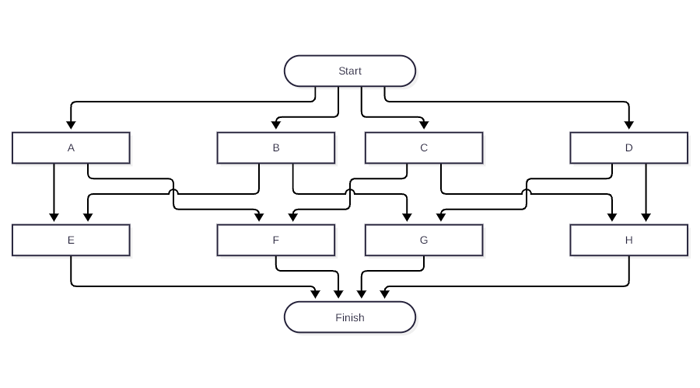
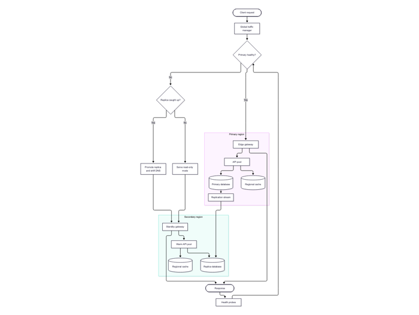
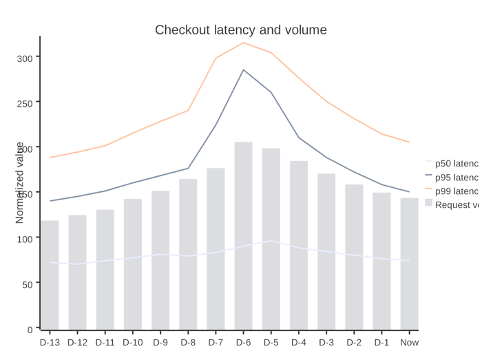
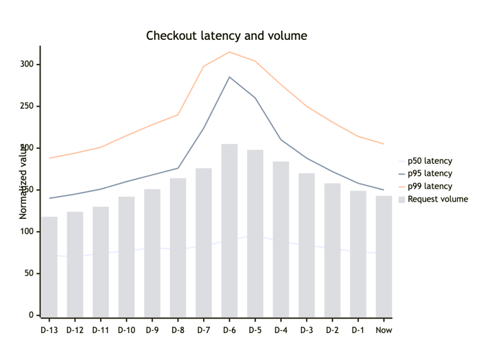
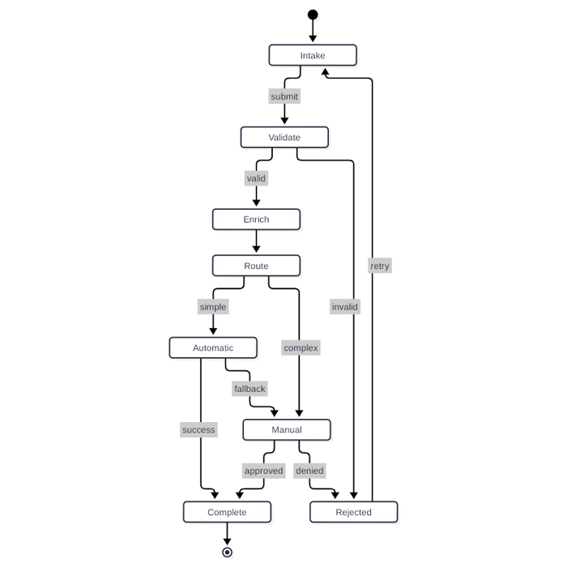
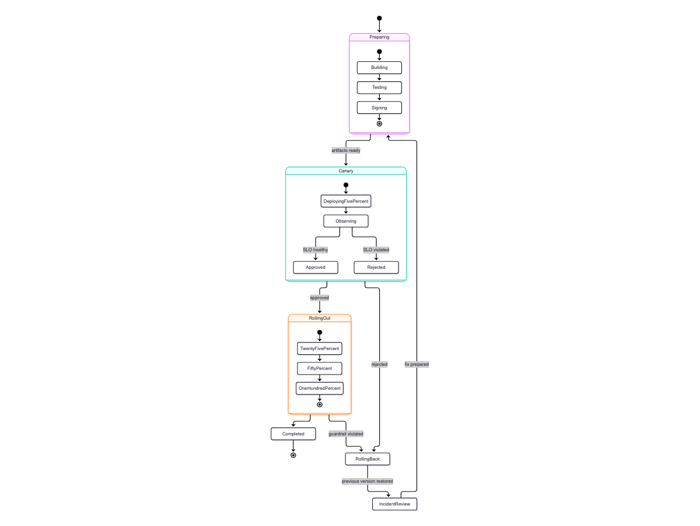
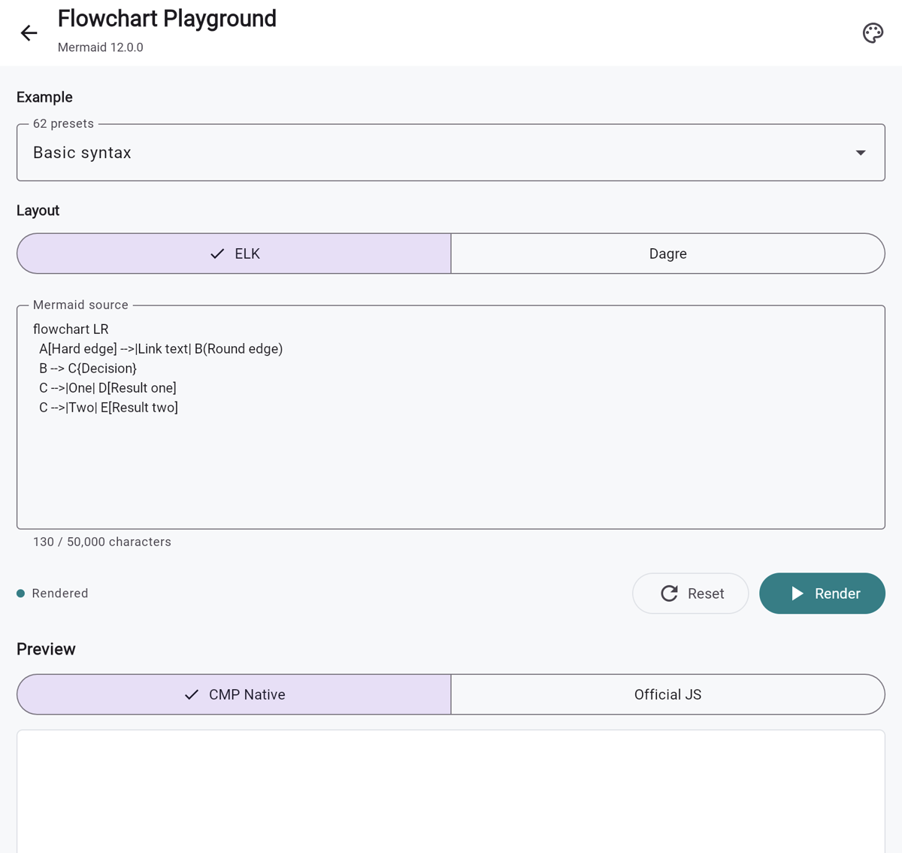

<div align="center">
  <h1>CMP Mermaid</h1>
  <p><a href="README.md">English</a> · <strong>简体中文</strong></p>
  <p><strong>面向 Kotlin 与 Compose Multiplatform 的原生 Mermaid 渲染器。</strong></p>
  <p>将 Mermaid <code>12.0.0</code> 语义翻译为 Kotlin，并通过 Compose Canvas 渲染。</p>
  <p>
    <a href="https://github.com/swithun-liu/cmp-mermaid/actions/workflows/quality.yml">
      
    </a>
    <a href="https://github.com/swithun-liu/cmp-mermaid/actions/workflows/deploy-pages.yml">
      
    </a>
    <a href="https://mermaid.js.org/">
      
    </a>
    <a href="LICENSE">
      
    </a>
  </p>
  <p>
    <a href="https://swithun-liu.github.io/cmp-mermaid/"><strong>在线 Web Demo</strong></a>
    ·
    <a href="docs/assets/stability-report/visual-parity-evidence.md"><strong>8,448 案例独立场景视觉报告</strong></a>
    ·
    <a href="docs/stability-report.md">完整稳定性报告</a>
    ·
    <a href="docs/full-diagram-roadmap.md">33 类图路线</a>
    ·
    <a href="#接入">接入</a>
  </p>
</div>

> [!IMPORTANT]
> **CMP Mermaid 当前已实现 Mermaid `12.0.0` 的全部 33 个官方图表家族。**
> Swimlanes 直接上游重译后的 classic-look 生产、256-case 视觉及逐边拓扑门禁均已通过。
> 但 Architecture 合法的 `randomize: true` 路径和合法的
> `look: handDrawn` 输入仍返回明确的
> `MermaidError.UnsupportedFeature`，另有 7 个细节案例待评审：
> Architecture 5 个、Kanban 2 个。因此整体 Mermaid `12.0.0` 契约
> **不是 Stable**。JVM 和 Wasm 的完整 Core 测试套件均已通过。
>
> 当前 **[8,448 案例 Native/Official 独立场景视觉报告](docs/assets/stability-report/visual-parity-evidence.md)**
> 为每个家族提供 256 份去除业务标题和标签后仍不同的 Mermaid source。
> Flowchart 保留专项 coverage 语料，其余 32 族使用八个家族能力轴的完整
> 256 组合矩阵。源码、重复、细节、几何及 528 页 contact sheet 均有门禁。
> 441 个手写生产场景和 8,448 个文本/布局压力输入作为独立证据层保留。

CMP Mermaid 面向需要在同一页面渲染多个图表的应用，无需为每个图表创建
WebView。生产渲染链路不内嵌 Mermaid.js、不包含网络客户端，也不需要
`android.permission.INTERNET`：解析、图表状态、布局准备、SceneGraph
生成和最终 Compose Canvas 绘制均由多平台库完成。

## 当前验证状态

全部 33 个已实现家族均有仓库内可复现的测试与语料、已发布的
Native/Official 截图，以及通过的替换版细节与几何门禁。

| 证据 | 结果 |
| --- | ---: |
| Mermaid 官方图表家族 | 33 |
| 已实现图表家族 | 33/33 |
| 待翻译 | Architecture `randomize: true` 的 spectral/Matrix/SVD 路径；非默认 packing、tiling、radial 和 bendpoint 分支仍明确标记为不支持 |
| Flowchart 逐边拓扑 | 256 个通过，0 个失败 |
| 待完成视觉门禁 | 0 |
| 独立生产场景 | 441 组 Native/Official 对拍 |
| 已声明能力覆盖率 | 738/738 |
| 独立场景视觉矩阵 | 8,448 组 Native/Official 对拍；Flowchart 使用专项 256-case 语料，其余每族覆盖八个能力轴的全部 256 种组合 |
| Coverage 硬门禁 | 每家族去标签源码均为 256/256；非 Flowchart 每个能力轴 128/128 均衡、任意两轴四种组合各 64 次，且每轴翻转都会改变全部 128 对源码 |
| 重复硬门禁 | 每家族的 blueprint、归一化语义和去标签源码均为 256/256 唯一；manifest/PNG 唯一数仅作诊断，因为不同合法输入可有等价渲染 |
| 文本/布局压力输入 | 从 441 个生产场景派生的 8,448 个字节级不同输入；独立统计，不计作结构覆盖 |
| Native/Official 截图 | 16,896 张独立场景截图，另有 882 张独立语料截图和 16,896 张异常源码截图 |
| 异常源码对齐 | 8,448/8,448 个 Official 接受/拒绝结果一致；6,292 个 Native 拒绝均为 `CONTENT_ERROR`；精确诊断文案单独统计；0 崩溃 |
| 独立场景细节审计 | 33 个家族：8,441 个 pass、7 个 review、0 个 fail |
| 自动视觉几何 | 8,448/8,448 组对拍：0 个 failure、0 个 review |
| 确定性 SceneGraph 重放 | 441 个通过，0 个不一致 |
| 内置主题矩阵 | 363/363 |
| 独立生成的 Native 压力输入 | 保留的历史基线 7,936 个 |
| 0.1.21 当前 JVM 测试 | Core：1,123 个通过、0 个失败；Compose：75 个通过、0 个失败 |
| 当前 Jison 解析表等价性 | 12 个家族、1,611 个状态和 20,857 个条目与官方 JS 完全一致，包括键顺序 |
| 当前容器宽度专项审计 | 2 个家族、3 份唯一源码、9 个配置场景、18 张截图和 3 页 contact sheet；0 Pass / 9 Review / 0 Fail |
| 0.1.21 当前 Wasm 测试 | Core：1,109 个通过、0 个失败；Compose：62 个通过、0 个失败；debug UI：保留历史 9 个通过 |
| 0.1.21 当前 iOS Simulator Arm64 测试 | Core：1,109 个通过、0 个失败；Compose：76 个通过、0 个失败 |
| Core 生产场景压力测试 | 历史 415 场景基线：2,075 次渲染，总耗时 674ms，P95 为 1ms，保留堆 63,968 bytes |
| 物理设备运行时矩阵 | Kotlin 2.3.20 Android 8/8、Kotlin 1.7.21 Android 8/8、iOS 6/6 通过；9,702 次语料渲染；人工审阅 198 张代表图和 22 张完成截图；0 崩溃、0 Android ANR |
| 运行时负载矩阵 | 三条物理设备轨道均完整通过 441 个场景；Web 保留此前 397 场景基线；iOS 模拟器和 Desktop 保留此前 236 场景基线 |

| 证据文档 | 内容 |
| --- | --- |
| **[全图表路线](docs/full-diagram-roadmap.md)** | 官方 33 家族清单和已完成的 33/33 家族门禁 |
| **[稳定性测试报告](docs/stability-report.md)** | 当前判定、视觉对比图、测试、压力指标、运行时负载证据和复现步骤 |
| **[0.1.21 解析表体积优化报告](docs/jison-table-size-report.md)** | 相同最小宿主的 iOS 测量：库符号占用 38.86 MB → 35.24 MB，解析表 5.20 MB → 1.57 MB；与实际 IPA 体积分开记录 |
| **[0.1.18 容器宽度修复报告](docs/container-width-report.md)** | 新鲜生成的 Gantt 父容器宽度、坐标取整和标签左右选择检查，以及相同配置下的 Mindmap 颜色和拓扑检查；视觉微差继续保留 Review |
| **[全部 8,448 个 Native/Official 独立场景](docs/assets/stability-report/visual-parity-evidence.md)** | 528 页分页对比图，每页包含 16 个不同的同源码场景 |
| **[异常源码 Native/Official 证据](docs/assets/invalid-source-report/invalid-source-evidence.md)** | 从 441 个结构场景的字节级不同压力样本派生的 8,448 个系统化变异、16,896 张截图和 528 张对比图 |
| **[Android 物理设备兼容性报告](docs/android-real-device-compatibility.md)** | Kotlin 2.3.20 与 Kotlin 1.7.21 分别覆盖 Android 9-16 |
| **[iOS 物理设备兼容性报告](docs/ios-real-device-compatibility.md)** | iOS 14.3-26.0 共 6 台设备的完整 441 场景负载 |
| [生产能力矩阵](docs/production-capability-matrix.md) | 738 项被独立验证的能力 |
| [生产就绪说明](docs/production-readiness.md) | 代码级 Stable 标准、资源预算和接入指引 |
| [Quality Gate](https://github.com/swithun-liu/cmp-mermaid/actions/workflows/quality.yml) | 当前 JVM、构建、发布、安全、APK、视觉和 Web 负载自动化结果 |
| [Full Visual Parity](https://github.com/swithun-liu/cmp-mermaid/actions/workflows/full-visual-parity.yml) | 全部 33 个家族的每周/手动截图与细节门禁 |
| [Full Invalid Source Matrix](https://github.com/swithun-liu/cmp-mermaid/actions/workflows/full-invalid-source.yml) | 每周/手动执行 33 × 256 组 Native/Official 异常源码安全矩阵 |

全部 33 个家族的最新证据门禁均已完成。刷新后的 Flowchart 矩阵包含
107 种唯一图拓扑，且 256 个逐边路由案例全部通过。整体 Mermaid `12.0.0`
支持仍**不是 Stable**，需要先解决 Architecture 缺口、7 个细节 Review
以及合法但尚不支持的 RoughJS-backed `handDrawn` look。
对于无法忠实表达的合法特性，系统会返回
`MermaidError.UnsupportedFeature`，而不是静默绘制可能误导用户的近似结果。

0.1.18 将 `MermaidRenderOptions.ganttUseWidth` 改为可空：缺省时读取
Compose 父容器内容宽度，显式值始终覆盖父容器；没有父容器的 Core
调用仍回退到 1200。调用方需针对新 API 重新构建。全家族与物理设备
矩阵保留历史证据，本轮新鲜证据以容器宽度专项报告为准。

## Native 与 Mermaid.js 对比

以下对比使用相同的 Mermaid 源码、主题、布局模式和固定 viewport。目标是语义等价、
视觉质量相当，而不是与浏览器输出像素级一致；不同平台的字体度量可能存在差异。

**Flowchart：多区域故障转移**

| CMP Native - Compose Canvas | Official - Mermaid.js `12.0.0` |
| :---: | :---: |
|  |  |

<details>
<summary><strong>更多同源码对比</strong></summary>

**XY Chart：柱线混合序列**

| CMP Native - Compose Canvas | Official - Mermaid.js `12.0.0` |
| :---: | :---: |
|  |  |

**State Diagram：标签、循环、分支和终止状态**

| CMP Native - Compose Canvas | Official - Mermaid.js `12.0.0` |
| :---: | :---: |
|  |  |

当前已发布测试报告包含 441 个独立生产场景对比和 8,448 个独立场景视觉
case。另有 8,448 个文本/布局压力输入用于发现换行和布局压力回归：
**[查看全部 528 页独立场景视觉证据](docs/assets/stability-report/visual-parity-evidence.md)**。

</details>

## 支持的图表

| 图表 | 状态 | 生产案例 | 主要覆盖能力 | 详情 |
| --- | :---: | ---: | --- | --- |
| Flowchart | 细节门禁通过 | 14 | Jison/FlowDB、Dagre、形状、连线、Markdown/HTML 标签 | [兼容性](docs/flowchart-compatibility.md) |
| XY Chart | 细节门禁通过 | 13 | Jison/XY DB、D3 比例尺和刻度、柱状图/折线图、标签 | [兼容性](docs/xychart-compatibility.md) |
| Quadrant Chart | 细节门禁通过 | 13 | 坐标轴、象限、点、共享类、直接样式、主题 | [兼容性](docs/quadrant-compatibility.md) |
| Timeline | 细节门禁通过 | 13 | LR/TD 布局、分区、时期、事件、色阶与主题 | [兼容性](docs/timeline-compatibility.md) |
| Kanban | 细节门禁通过 | 13 | 分区、任务、元数据、优先级、工单链接与主题 | [兼容性](docs/kanban-compatibility.md) |
| Sequence | 细节门禁通过 | 14 | 参与者、26 种消息形式、注释、激活、控制区域 | [兼容性](docs/sequence-compatibility.md) |
| Class | 细节门禁通过 | 13 | 分区、泛型、命名空间、关系、Dagre | [兼容性](docs/class-compatibility.md) |
| State | 细节门禁通过 | 13 | 复合状态、并发、注释、分叉/汇合、Dagre | [兼容性](docs/state-compatibility.md) |
| Entity Relationship | 细节门禁通过 | 13 | 属性、基数、关系、嵌套子图 | [兼容性](docs/er-compatibility.md) |
| Gantt | 细节门禁通过 | 13 | 日期、依赖、排除日期、里程碑、D3 风格刻度 | [兼容性](docs/gantt-compatibility.md) |
| Pie | 细节门禁通过 | 13 | Langium 语法、D3 角度、环形图、图例、调色板 | [兼容性](docs/pie-compatibility.md) |
| User Journey | 细节门禁通过 | 13 | 分区、评分、参与者、满意度表情和文本策略 | [兼容性](docs/journey-compatibility.md) |
| Requirement | 细节门禁通过 | 13 | SysML 类型与字段、元素、七类关系、Dagre、样式 | [兼容性](docs/requirement-compatibility.md) |
| Git Graph | 细节门禁通过 | 13 | Langium 语法、分支、合并、cherry-pick、方向与主题 | [兼容性](docs/gitgraph-compatibility.md) |
| Mindmap | 细节门禁通过 | 13 | Jison/Mindmap DB、CoSE-Bilkent、Dagre、tidy tree、形状与主题 | [兼容性](docs/mindmap-compatibility.md) |
| Packet | 细节门禁通过 | 13 | Langium 语法、显式/计数字段、跨行拆分与固定网格渲染 | [兼容性](docs/packet-compatibility.md) |
| Radar | 细节门禁通过 | 13 | Langium 语法、坐标轴、曲线、网格、图例与主题 | [兼容性](docs/radar-compatibility.md) |
| Sankey | 细节门禁通过 | 13 | CSV 语法、D3 Sankey 布局、对齐、数值标签、链路与节点颜色 | [兼容性](docs/sankey-compatibility.md) |
| Treemap | 细节门禁通过 | 13 | Langium 语法、D3 层级与 squarify 布局、类样式、数值和响应式尺寸 | [兼容性](docs/treemap-compatibility.md) |
| Venn | 细节门禁通过 | 13 | Jison 语法、Venn.js/fmin 优化、加权交集、样式与文本节点 | [兼容性](docs/venn-compatibility.md) |
| Ishikawa | 细节门禁通过 | 13 | Jison 缩进语法、上下交替递归分支、鱼头几何与文本换行 | [兼容性](docs/ishikawa-compatibility.md) |
| Cynefin | 细节门禁通过 | 13 | 五域、确定性边界、Confusion 溢出、迁移、主题 | [兼容性](docs/cynefin-compatibility.md) |
| Event Modeling | 细节门禁通过 | 13 | Langium 语法、帧、泳道、数据、关系、校验与主题 | [兼容性](docs/eventmodeling-compatibility.md) |
| Agentflow | 细节门禁通过 | 13 | Jison 语法、类型化节点与边、嵌套/全局/折叠 flow、连接器、元数据与 Dagre | [兼容性](docs/agentflow-compatibility.md) |
| Block | 细节门禁通过 | 13 | Jison 语法、网格、跨列、复合块、形状、块箭头、连线、类与样式 | [兼容性](docs/block-compatibility.md) |
| Swimlanes | 已重验；handDrawn 不支持 | 13 | Flowchart 语法与形状、泳道感知 Sugiyama 布局、正交路由、方向变换、256/256 拓扑通过 | [兼容性](docs/swimlanes-compatibility.md) |
| Architecture | 细节门禁通过 | 13 | Langium 语法、服务、分组、连接点、定向连线、约束 fCoSE 布局与图标 | [兼容性](docs/architecture-compatibility.md) |
| C4 | 细节门禁通过 | 13 | 五类 C4 层级、嵌套边界、部署节点、关系变体、样式与配置 | [兼容性](docs/c4-compatibility.md) |
| Railroad | 细节门禁通过 | 18 | Railroad IR、EBNF、ABNF、PEG、共享 AST、语法路径、样式与配置 | [兼容性](docs/railroad-compatibility.md) |
| TreeView | 细节门禁通过 | 13 | 缩进与框线语法、层级、注解、描述、图标、样式与配置 | [兼容性](docs/treeview-compatibility.md) |
| Use Case | 细节门禁通过 | 18 | Actor、边界、UML 关系、注释、JSON 表格、样式与配置 | [兼容性](docs/usecase-compatibility.md) |
| Wardley Map | 细节门禁通过 | 13 | 价值链、采购策略、演进、Pipeline、注解与战略作用力 | [兼容性](docs/wardley-compatibility.md) |
| ZenUML | 细节门禁通过 | 13 | 参与者、嵌套调用、返回、分组、控制片段与参与者图标 | [兼容性](docs/zenuml-compatibility.md) |

在各自文档声明的兼容范围内，已实现的 33 类图均支持 Mermaid frontmatter、相关 metadata、
Unicode 和相关主题变量。

## 在线体验

打开 **[Kotlin/Wasm 在线 Demo](https://swithun-liu.github.io/cmp-mermaid/)**，
可以浏览语法、渲染 Gallery、切换全部 11 个主题，并比较 CMP Native 与锁定版本
Mermaid.js 的结果。每种受支持的图表都有可编辑的 Playground，并支持切换
Native/Official 预览；Mindmap 可在 CoSE-Bilkent、Dagre 与 tidy-tree
布局间切换。

<a href="https://swithun-liu.github.io/cmp-mermaid/">
  
</a>

Official 对比渲染器只存在于 `mermaid-debug-ui`。
`mermaid-core` 和 `mermaid-compose` 从不使用 Mermaid.js。

## 架构

```text
Mermaid source
    -> Kotlin preprocessor and translated parser
    -> translated diagram database and layout preparation
    -> platform-independent MermaidScene
    -> Compose Canvas
```

- `mermaid-core` 负责解析、图表状态、布局适配器、类型化错误、主题和平台无关
  SceneGraph。
- `mermaid-compose` 负责 Canvas 绘制、文本测量、资源、交互和拖动/缩放行为。
- `mermaid-debug-ui` 负责文档、Gallery、Playground、Official 对比和负载测试页面。
  它是可选模块，应与生产 release variant 隔离。
- `sample/*` 包含 Android、iOS、Desktop 和 Web 的轻量启动壳，共享同一套
  debug UI。

生产库不包含 JavaScript 引擎，也不打包 JavaScript 算法。统一布局默认使用纯
Kotlin Dagre。ELK 名称和 `flowchart-elk` 仍会作为上游输入被识别，但会返回
`MermaidError.UnsupportedFeature("ELK layout")`，绝不会静默替换为其他布局。

## 接入

当前发布坐标如下：

| 使用方 | 制品 |
| --- | --- |
| 当前 Kotlin Multiplatform | `io.github.swithun-liu:mermaid-core:0.1.21` |
| 当前 Compose Multiplatform | `io.github.swithun-liu:mermaid-compose:0.1.21` |
| Kotlin `1.7.21` Android | `io.github.swithun-liu:mermaid-core-android-kotlin17:0.1.21` |
| Kotlin `1.7.21` Android Compose | `io.github.swithun-liu:mermaid-compose-android-kotlin17:0.1.21` |
| iOS 二进制 | `CMPMermaid` CocoaPod `0.1.21` |

当前 Kotlin Multiplatform 项目：
```kotlin
dependencies {
    implementation("io.github.swithun-liu:mermaid-compose:0.1.21")
}
```

> [!NOTE]
> 上述 Maven 坐标已经发布，可从已配置的公开制品库解析。CocoaPods
> 分发仍使用独立的二进制发布链路。

固定使用 Kotlin `1.7.21` 的 Android 项目应依赖隔离的 Android 制品：

```kotlin
dependencies {
    implementation(
        "io.github.swithun-liu:mermaid-compose-android-kotlin17:0.1.21",
    )
}
```

Kotlin `1.7.21` 制品仅支持 Android，目标为 JVM 1.8，最低 Android API
为 24。其制品名与当前 KMP 模块刻意隔离，避免使用方意外解析 Kotlin 2.x
元数据。

基于 Android View 的宿主可以复用同一个 Compose 渲染器，无需编译 Compose
源码：

```kotlin
val diagramView = CMPMermaidView(context).apply {
    setMermaidSource("flowchart LR\n  A --> B")
    setMermaidContentDescription("Mermaid 示例图")
}
container.addView(diagramView)
```

当前 Android target 与 Kotlin `1.7.21` Android 制品都提供
`CMPMermaidView`。

iOS 项目可以通过 CocoaPods 使用预编译的静态 XCFramework：

```ruby
pod 'CMPMermaid', '0.1.21'
```

二进制向 Swift 暴露
`CMPMermaidViewControllerFactory.makeViewController(...)`，并包含渲染所需的
全部字体资源。它支持 iOS arm64 真机以及 arm64/x86_64 模拟器，最低版本为
iOS 14。

直接依赖源码仓库模块：

```kotlin
dependencies {
    implementation(project(":mermaid-compose"))
    debugImplementation(project(":mermaid-debug-ui"))
}
```

Compose 基本用法：

```kotlin
import androidx.compose.foundation.layout.fillMaxWidth
import androidx.compose.runtime.Composable
import androidx.compose.ui.Modifier
import com.swithun.cmpmermaid.compose.MermaidDiagram
import com.swithun.cmpmermaid.core.MermaidTheme
import com.swithun.cmpmermaid.core.MermaidThemePreset

@Composable
fun Diagram(source: String) {
    MermaidDiagram(
        source = source,
        modifier = Modifier.fillMaxWidth(),
        theme = MermaidTheme.preset(MermaidThemePreset.Default),
        contentDescription = "Mermaid diagram",
    )
}
```

渲染失败时，Compose 画面显示 Mermaid.js `12.0.0` 的标准错误图；
`onError` 与 `onRenderResult` 仍保留带原始源码的详细类型化诊断。已发布的
异常源码语料验证了全部 8,448 个变异的 Native/Official 接受/拒绝结果一致；
精确诊断文案一致性单独统计为 1,798/6,292，不作为伪造的兼容性要求。

在 `build/maven-repository` 下生成全部 KMP 发布制品：
```bash
./gradlew \
  :mermaid-core:publishAllPublicationsToBuildRepository \
  :mermaid-compose:publishAllPublicationsToBuildRepository
```

使用 JDK 11 生成 Kotlin `1.7.21` Android 制品：

```bash
./android-legacy-build/gradlew -p android-legacy-build \
  assembleRelease \
  verifyLegacyPublicationCoordinates \
  publishLegacyToReleaseRepository
```

使用 JDK 17 生成并校验静态 iOS 二进制：

```bash
./gradlew :mermaid-compose:podPublishReleaseXCFramework
tools/release/verify-ios-xcframework.sh
```

### 自动发布

Quality Gate 只构建一次 iOS XCFramework，并在完整校验后连同精确 source commit
保存。推送 `v*` tag 后，现代 KMP 与 Kotlin `1.7.21` Android 制品会并行构建，
iOS 则只复用该不可变 tag commit 对应的、整个 `main` push Quality Gate
成功后保留的已验证制品。三路产物汇合后仍会再次执行完整发布校验，随后流水线
才会写入公开制品仓库。

发布中断时会保留 prerelease 和 14 天有效的已验证 workflow artifact。可以直接
重跑失败任务，也可以在 `Release` workflow 中手动指定同一个不可变 tag 恢复发布。
每次写入前都会先核对 Maven Central 和 CocoaPods；已经公开的版本只做回读验证，
不会重复上传。

## 主题

包含 Mermaid `12.0.0` 的全部 11 个预设主题：
`default`、`dark`、`forest`、`neutral`、`base`、`neo`、`neo-dark`、
`redux`、`redux-color`、`redux-dark` 和 `redux-dark-color`。

业务主题可以通过 Kotlin `copy` 从预设主题派生，也可以通过
`MermaidTheme.withVariables(...)` 使用 Mermaid 兼容的 `themeVariables`。
无效外部值会返回 `GMResult.Err`。

```kotlin
val brandTheme = MermaidTheme.preset(MermaidThemePreset.ReduxColor).copy(
    background = SceneColor(0xFF101820),
    nodeFill = SceneColor(0xFFF2AA4C),
    nodeText = SceneColor(0xFF101820),
    edge = SceneColor(0xFFF2AA4C),
)
```

任意 `themeCSS` 依赖浏览器 DOM/CSS 语义，因此会返回
`MermaidError.UnsupportedFeature`。跨平台样式应使用类型安全的 Kotlin 主题对象
和 `MermaidFontFamilyResolver`。

## 跟随 Mermaid 版本

CMP Mermaid 采用带源码映射的翻译工作流，而不是根据截图重新实现行为：

1. 锁定 Mermaid、Jison、D3、Marked、Dagre、CoSE-Bilkent 和 tidy-tree 版本。
2. 将每个 Kotlin parser、DB、layout、shape、theme 和 renderer 边界映射到
   Mermaid 上游源码。
3. 根据锁定的输入生成 parser table、rule、entity、fixture 和仅用于调试的参考资源。
4. Mermaid 升级时只翻译上游增量。
5. 重新运行完整视觉对拍和平台门禁。

源码映射：
[Flowchart](docs/upstream-flowchart-map.md) ·
[XY Chart](docs/upstream-xychart-map.md) ·
[Quadrant Chart](docs/upstream-quadrant-map.md) ·
[Timeline](docs/upstream-timeline-map.md) ·
[Kanban](docs/upstream-kanban-map.md) ·
[Sequence](docs/upstream-sequence-map.md) ·
[Class](docs/upstream-class-map.md) ·
[State](docs/upstream-state-map.md) ·
[ER](docs/upstream-er-map.md) ·
[Gantt](docs/upstream-gantt-map.md) ·
[Pie](docs/upstream-pie-map.md) ·
[User Journey](docs/upstream-journey-map.md) ·
[Requirement](docs/upstream-requirement-map.md) ·
[Git Graph](docs/upstream-gitgraph-map.md) ·
[Mindmap](docs/upstream-mindmap-map.md) ·
[Packet](docs/upstream-packet-map.md) ·
[Radar](docs/upstream-radar-map.md) ·
[Sankey](docs/upstream-sankey-map.md) ·
[Treemap](docs/upstream-treemap-map.md) ·
[Venn](docs/upstream-venn-map.md) ·
[Ishikawa](docs/upstream-ishikawa-map.md) ·
[Cynefin](docs/upstream-cynefin-map.md) ·
[Event Modeling](docs/upstream-eventmodeling-map.md) ·
[Agentflow](docs/upstream-agentflow-map.md) ·
[Block](docs/upstream-block-map.md)

## 验证

运行 JVM 与发布门禁：

```bash
./gradlew \
  :mermaid-core:jvmTest \
  :mermaid-compose:jvmTest \
  verifyPublicationCoordinates
```

运行示例应用：

```bash
./gradlew :sample:androidApp:installDebug
./gradlew :sample:desktopApp:run
./gradlew :sample:webApp:wasmJsBrowserDevelopmentRun
```

**[稳定性测试报告](docs/stability-report.md#reproduce-the-report)**
包含完整的跨平台构建和 Native/Official 视觉证据复现命令。

## 许可证

CMP Mermaid 采用 [MIT License](LICENSE) 发布。
翻译后的 Mermaid 行为和仅用于开发的参考资源保留其上游声明，详见
[THIRD_PARTY_NOTICES.md](THIRD_PARTY_NOTICES.md)。
