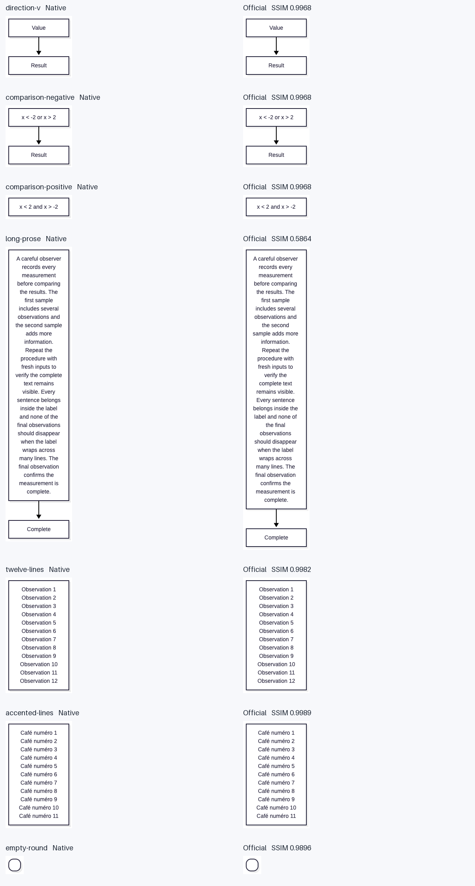
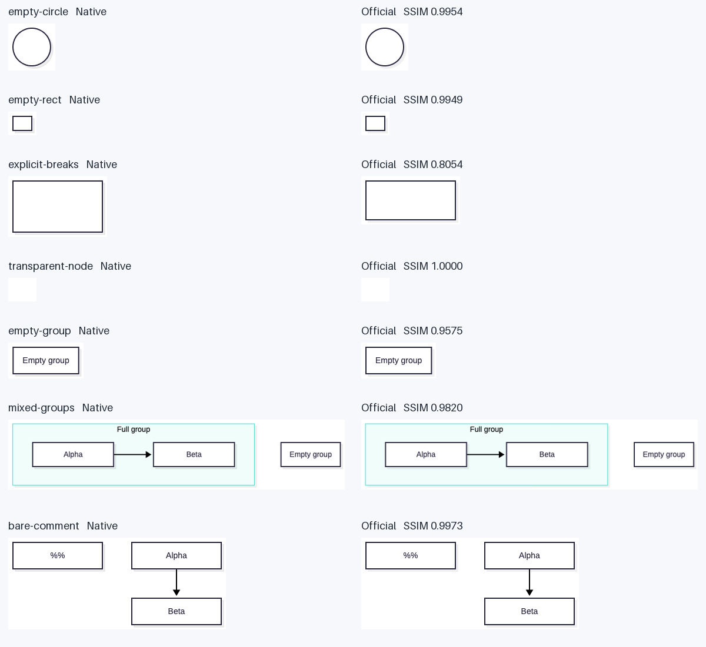
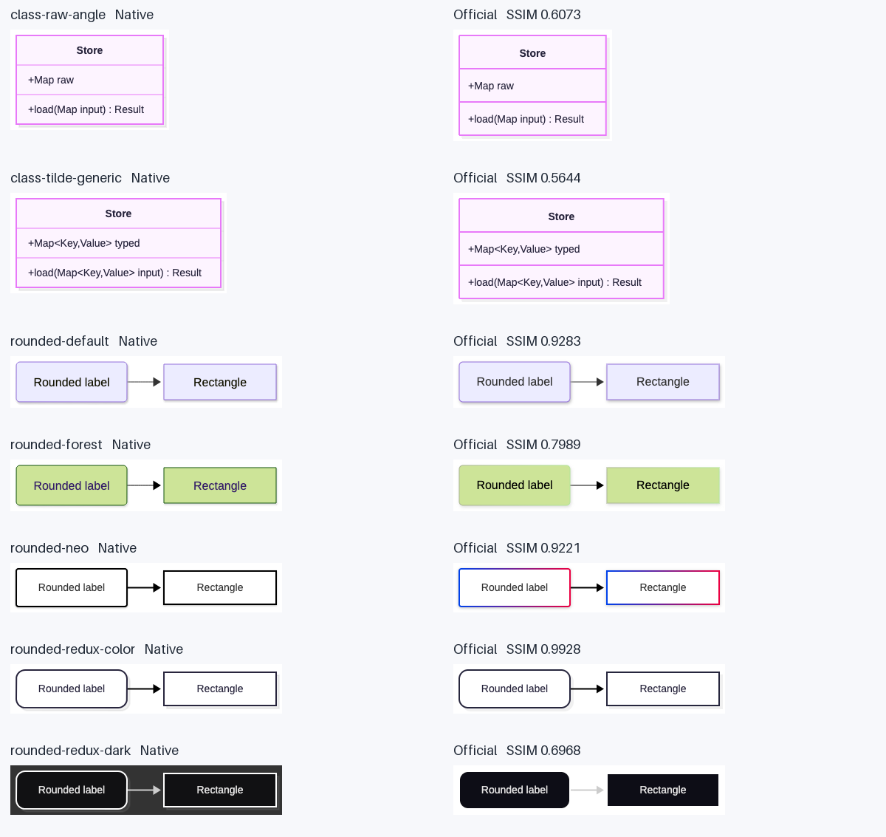
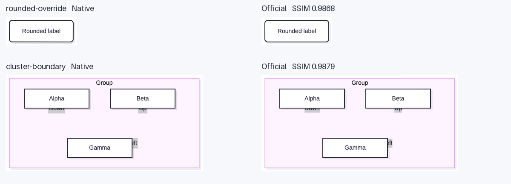

# Label compatibility evidence

Mermaid.js **12.0.0**, explicit **Dagre**, bundled Arimo/Arial, default
`redux-color` with source-defined theme overrides. Native uses Compose JVM.

2 families, 23 unique same-source inputs,
46 screenshots, 4 contact sheets:
**13 Pass / 10 Review / 0 Fail**.
All label content checks pass. Review findings remain visible in the audit;
they are not promoted to Pass. This evidence does not establish mobile parity
or full-family Stable status.

- [Source and screenshot manifest](visual-parity-manifest.json)
- [Detail, node geometry, rendered endpoints and per-edge topology](audit.json)
- [Raster scores](raster.json)
- [Native capture](native.json)
- [Official capture](official.json)

## Contact sheets

## Individual captures

| Case | Family | Result | Native | Official |
| --- | --- | --- | --- | --- |
| direction-v | flowchart | pass | [PNG](direction-v-native.png) | [PNG](direction-v-official.png) |
| comparison-negative | flowchart | pass | [PNG](comparison-negative-native.png) | [PNG](comparison-negative-official.png) |
| comparison-positive | flowchart | pass | [PNG](comparison-positive-native.png) | [PNG](comparison-positive-official.png) |
| long-prose | flowchart | review | [PNG](long-prose-native.png) | [PNG](long-prose-official.png) |
| twelve-lines | flowchart | pass | [PNG](twelve-lines-native.png) | [PNG](twelve-lines-official.png) |
| accented-lines | flowchart | pass | [PNG](accented-lines-native.png) | [PNG](accented-lines-official.png) |
| empty-round | flowchart | pass | [PNG](empty-round-native.png) | [PNG](empty-round-official.png) |
| empty-circle | flowchart | review | [PNG](empty-circle-native.png) | [PNG](empty-circle-official.png) |
| empty-rect | flowchart | pass | [PNG](empty-rect-native.png) | [PNG](empty-rect-official.png) |
| explicit-breaks | flowchart | review | [PNG](explicit-breaks-native.png) | [PNG](explicit-breaks-official.png) |
| transparent-node | flowchart | pass | [PNG](transparent-node-native.png) | [PNG](transparent-node-official.png) |
| empty-group | flowchart | review | [PNG](empty-group-native.png) | [PNG](empty-group-official.png) |
| mixed-groups | flowchart | pass | [PNG](mixed-groups-native.png) | [PNG](mixed-groups-official.png) |
| bare-comment | flowchart | pass | [PNG](bare-comment-native.png) | [PNG](bare-comment-official.png) |
| class-raw-angle | class | review | [PNG](class-raw-angle-native.png) | [PNG](class-raw-angle-official.png) |
| class-tilde-generic | class | review | [PNG](class-tilde-generic-native.png) | [PNG](class-tilde-generic-official.png) |
| rounded-default | flowchart | review | [PNG](rounded-default-native.png) | [PNG](rounded-default-official.png) |
| rounded-forest | flowchart | review | [PNG](rounded-forest-native.png) | [PNG](rounded-forest-official.png) |
| rounded-neo | flowchart | review | [PNG](rounded-neo-native.png) | [PNG](rounded-neo-official.png) |
| rounded-redux-color | flowchart | pass | [PNG](rounded-redux-color-native.png) | [PNG](rounded-redux-color-official.png) |
| rounded-redux-dark | flowchart | review | [PNG](rounded-redux-dark-native.png) | [PNG](rounded-redux-dark-official.png) |
| rounded-override | flowchart | pass | [PNG](rounded-override-native.png) | [PNG](rounded-override-official.png) |
| cluster-boundary | flowchart | pass | [PNG](cluster-boundary-native.png) | [PNG](cluster-boundary-official.png) |
