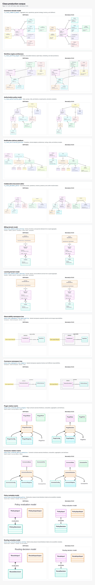

# Class terminal-label repair report

Release **0.1.20**; Mermaid.js **12.0.0** baseline.

The [source inventory](upstream-class-terminal-map.md) maps each terminal
stage. The repair translates the complete `calcTerminalLabelPosition`
function and retains Class marker-string truthiness, including `"none"`.
It removes the non-upstream obstacle-avoidance and short-path clamping stages.
Short/empty/singleton traversal failures return `GMResult.Err`.

The official HTML label box can contain blank space because `setTerminalWidth`
sets its width to `value.length * 9`. Occlusion now uses actual DOM text-range
rectangles separately from the layout box. The detection thresholds remain
unchanged. Real-browser tests verify blank space, true occlusion, separate
text rows, hidden text and inverse SVG transforms.

## Evidence

The [source-bound manifest](assets/class-terminal-report/visual-parity-manifest.json)
contains **13 Class sources / 26 screenshots / one contact sheet**.
The [detail audit](assets/class-terminal-report/detail.json),
[geometry audit](assets/class-terminal-report/geometry.json) and
[topology audit](assets/class-terminal-report/topology.json) each pass 13 cases.
Topology compares per-edge point/bend counts, direction sequences, port
sides, shared tracks, crossings and shared endpoints. Class ID separators
are normalized solely to identify corresponding edges.

Overall visual status remains **0 Pass / 13 Review / 0 Fail**: text/node
dimensions, absolute endpoint coordinates, compartment heights and raster
differences remain visible. These are independent of terminal placement and
are not promoted by the coarse geometry gate.

The [occlusion comparison](assets/class-terminal-report/occlusion-comparison.json)
retains the commerce model's actual clipped `0..*` text: Native and Official
each contain one occlusion, with zero differences after the repair. Blank HTML
container space previously caused four additional false detections. The old
Native implementation still fails for the real occlusion under the corrected
audit. Before/after Native captures use different platform font metrics, so
they do not establish absolute path-coordinate identity.

The [utility oracle](assets/class-terminal-report/terminal-oracle.json)
executes unchanged upstream source for 48 terminal cases covering four
positions, two marker sizes, bent paths, duplicate points and failure paths.
Common tests check fixed official coordinates and Class scene positions.
JVM Core **1,108** and Compose **75** tests pass; the audit regression suite
passes **79** tests. Wasm Core **1,106** and Compose **62** tests pass.
iOS Simulator Arm64 Core **1,106** and Compose **76** tests pass.
The Web production distribution also builds successfully.



This supplement is separate from the retained
[32-source label audit](label-compatibility-report.md),
[rectangle reproduction](rectangle-occlusion-audit.md) and historical
33-family matrix. It does not establish full-family Stable status or represent
a mobile 1,000-case rerun.

## Reproduction

Use the Web production application and the existing public production corpus:

```bash
AUDIT_SOURCE=production AUDIT_KIND=class VIEWPORT_WIDTH=1200 \
  VIEWPORT_HEIGHT=900 OUTPUT_DIR=captures/local/class-terminal \
  node tools/official-reference/capture-web-audit.mjs
CORPUS_SOURCE=production CORPUS_KIND=class \
  INPUT_DIR=captures/local/class-terminal \
  node tools/official-reference/audit-capture-geometry.mjs
node tools/official-reference/generate-edge-label-oracle.mjs \
  build/terminal-oracle.json
```
