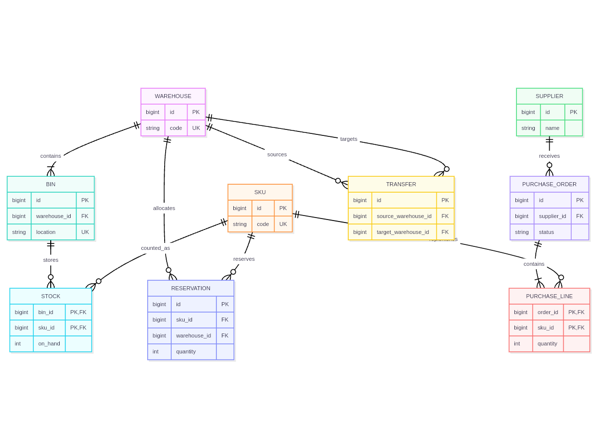
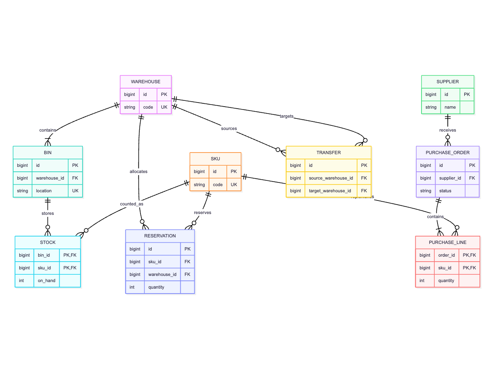

# SVG rectangle occlusion audit repair

Release: **0.1.20**. Mermaid.js baseline: **12.0.0**.

The `rc_er_inventory_network` OSS corpus reproduction moves the `replenishes`
edge label into the `TRANSFER` node through the faithfully translated final
edge-label stage. Official covers the label too. Production preserves this
overlap and its original layer order.

The prior audit recognized Native rectangles and Official `node-bkg` paths
as opaque regions. It missed Official's unclassified Rough.js rectangle path,
incorrectly reporting a Native-only occlusion. Upstream
`rendering-util/rendering-elements/shapes/erBox.ts -> erBox` uses
`rc.rectangle` for the outer and row backgrounds; `createGraph.ts ->
createLayoutElementGroups` puts nodes above edge labels.

The capture now records the actual SVG `d` and DOM-to-SVG transform. The
audit recognizes only a single axis-aligned four-corner `M`/`L` rectangle,
including SVG's implicit fill closure. It rejects curves, multiple subpaths,
transparent fill, rotations and skew. Detection thresholds and production
placement are unchanged. True paint-order differences remain failures.

## Evidence

One public source, two screenshots: **0 Pass / 1 Review / 0 Fail** overall.
The [detail audit](assets/rectangle-occlusion-audit/audit.json) detects one
occluded text occurrence on each side, with zero occlusion differences.
The [geometry audit](assets/rectangle-occlusion-audit/geometry.json) passes.
Independent node/text geometry and raster differences retain visual Review.
The evidence uses the 0.1.19 production implementation, unchanged in 0.1.20;
its manifests and images retain SHA-256 bindings.

The audit suite passes 77 tests, including real Rough.js output and
negative cases that preserve failures for genuine occlusion differences.
This supplemental reproduction is separate from the
[32-source edge-label audit](label-compatibility-report.md) and the retained
historical 33-family matrix. It does not establish full visual compatibility
or Stable status.
