# Mermaid 12.0.0 Stability Test Report

> [!NOTE]
> This report retains corpus evidence for all 33 official Mermaid `12.0.0`
> families, including the directly retranslated Swimlanes implementation.
> Swimlanes classic-look gates are complete, but Swimlanes remains
> **not Stable** because the legal RoughJS-backed `look: handDrawn` capability
> returns a structured unsupported result. Architecture also remains
> non-Stable because legal `randomize: true` input returns a structured
> unsupported result. Seven detail cases remain under review: five
> Architecture and two Kanban. Provider-backed formula rendering is also
> **not Stable**: shared-text mixed and multiple-formula composition is translated,
> but Sequence, ZenUML, Event Modeling, nested formula HTML, and HTML block
> formatting remain unsupported. A separate 28-source composition audit is
> linked below; the large corpus and physical-device matrices predate this
> formula change, the 0.1.17 label repairs and the subsequent container-width
> and 0.1.19 edge-label repairs and were not regenerated for those changes.
> The fresh label repair audit covers 32 sources, 64 screenshots and
> five contact sheets: 14 Pass, 18 Review, 0 Fail. The full JVM and
> Wasm core suites pass.
> Release 0.1.20 preserves the edge-label production implementation tested
> at 0.1.19 and corrects a rectangle-path occlusion audit false positive.
> Its separate [one-source reproduction](rectangle-occlusion-audit.md)
> has two screenshots and remains visual Review.
> The separate [0.1.20 Class terminal repair](class-terminal-report.md)
> adds 13 fresh sources, 26 screenshots and one contact sheet. Detail,
> geometry and route topology each pass 13 cases; text/node dimensions and
> absolute endpoint differences retain overall 13 Review.
> Release 0.1.21 changes only generated Jison table construction. All 1,611
> states and 20,857 entries match the official JavaScript oracle, including
> key order. The [size report](jison-table-size-report.md) records a 3.61 MB
> reduction against 0.1.20 under identical iOS consumer/link conditions.
> This does not refresh the historical 8,448-pair or physical-device matrices.
> Kotlin 2.3.20 Android, Kotlin 1.7.21 Android,
> and iOS retain separate historical 441-case physical-device matrices. Core soak,
> iOS Simulator, Desktop, and Web runtime measurements remain explicitly
> identified by their measured corpus sizes. See the
> [33-family roadmap](full-diagram-roadmap.md).

This report records published visual evidence for all 33 CMP Mermaid families.
The evidence is deliberately separate from the demo gallery and distinguishes
441 hand-authored production scenarios, 8,448 independent-scenario visual
cases, 8,448 derived text/layout stress inputs, and Native-only randomized
stress inputs.

## Decision

| Item | Result |
| --- | --- |
| Current rating | **Not Stable: Architecture `randomize: true`, `look: handDrawn`, and remaining formula stages are unsupported; historical Architecture/Kanban, 18 current label cases and 13 Class terminal cases remain under review** |
| Mermaid compatibility baseline | `12.0.0` |
| Implemented families | 33/33; retained 33-family corpus evidence, separate formula and current label audits |
| Independent production scenarios | 441: 167 release-candidate cases plus 274 additional conformance cases |
| Declared capability coverage | 738/738 points across 33 diagram types |
| Independent-scenario visual matrix | 8,448 Native/Official pairs: Flowchart uses its dedicated corpus; every other family covers all 256 combinations of eight capability axes |
| Coverage hard gate | All 33 families have 256/256 label-normalized sources; non-Flowchart axes are balanced, pairwise complete, and source-effective |
| Duplicate hard gate | All 33 families have 256/256 unique blueprints, normalized semantic structures, and label-normalized sources; rendered manifest/PNG uniqueness is diagnostic because distinct legal inputs can render equivalently |
| Text/layout stress inputs | 8,448 byte-distinct inputs derived from the 441 production scenarios; no additional structural coverage |
| Source-mutation parity | 8,448/8,448 Official accept/reject outcomes matched: 2,156 accepted and 6,292 rejected; all 6,292 Native rejections were `CONTENT_ERROR`; 16,896 screenshots; 0 crashes or timeouts |
| Native core render results | 441 production scenarios and all 8,448 independent visual scenarios render successfully; the text/layout stress inputs are tracked separately |
| Web Native/Official captures | 16,896 independent-scenario screenshots plus 882 independent-corpus and 16,896 malformed-source screenshots |
| Visual evidence | 528 freshly generated independent-scenario sheets plus 528 source-mutation sheets across all 33 families |
| Independent-scenario detail audit | 8,448/8,448 processed: 8,441 pass, 7 review, 0 fail |
| Automated visual geometry | 8,448/8,448 processed: 0 failure, 0 review findings |
| Flowchart per-edge topology | 256 processed: 256 pass, 0 fail |
| Deterministic SceneGraph replay | 441 passed, 0 mismatches |
| Built-in theme matrix | 363/363 renders passed: 33 diagram types by 11 themes |
| Separate deterministic Native stress inputs | 7,936 |
| JVM tests | Core: 1,094 passed, 0 failed; Compose: 73 passed, 0 failed |
| Current container-width JVM tests | Core: 1,100 passed, 0 failed; Compose: 75 passed, 0 failed |
| Historical 0.1.20 JVM tests | Core: 1,108 passed, 0 failed; Compose: 75 passed, 0 failed |
| Current 0.1.21 JVM tests | Core: 1,123 passed, 0 failed; Compose: 75 passed, 0 failed |
| Current 0.1.21 Jison table oracle | 12 family tests: 1,611 states / 20,857 entries, exact key order and action values; 3 construction tests and 2 emitter tests passed |
| Current release tooling | 13 tests passed, 0 failed |
| Current 0.1.21 Wasm tests | Core: 1,109 passed, 0 failed; Compose: 62 passed, 0 failed; debug UI: historical 9 passed, 0 failed |
| Current 0.1.21 iOS Simulator Arm64 tests | Core: 1,109 passed, 0 failed; Compose: 76 passed, 0 failed |
| Current rectangle/text-content audit | 79 audit tests passed; true occlusion differences remain failures; separate rectangle and Class reproductions retain visual Review |
| Current Class terminal evidence | 13 sources, 26 screenshots, one contact sheet; detail/geometry/topology each pass 13; overall 13 Review for text/node and absolute endpoint differences |
| Core production soak | 2,075 renders; 674ms total; 1ms P95; 63,968 bytes retained heap |
| Physical-device runtime matrix | Kotlin 2.3.20 Android 8/8, Kotlin 1.7.21 Android 8/8, and iOS 6/6 passed; 9,702 corpus renders; 198 reviewed sentinels plus 22 completion screenshots; 0 crashes or Android ANRs |
| Runtime load matrix | All three physical-device tracks passed the complete 441-case corpus; Web retains the preceding 397-scenario baseline; iOS Simulator and Desktop retain the prior 236-scenario baseline |
| Platform build matrix | Android debug/release, Web production, Desktop distributable, iOS Arm64, iOS Simulator Arm64, iOS X64 passed |
| Android Internet permission | Not declared in debug or release APK |
| Public-source safety scan | No organization-specific endpoint or credential pattern found |
| Formula renderer evidence | Unit-tested shared-label composition and provider contract; separate 28-source / 56-screenshot Native/Official audit; physical-device formula parity not established; non-Stable |
| Current label repair evidence | 4 families, 32 unique sources, 64 screenshots, 5 contact sheets; 14 Pass / 18 Review / 0 Fail; all label content and cluster-boundary path/topology checks pass; two generic cases improve six label anchors against 0.1.18, with all 32 edge-path sets unchanged |
| Current container-width repair evidence | 2 families, 3 unique sources, 9 configuration scenarios, 18 screenshots, 3 contact sheets; 0 Pass / 9 Review / 0 Fail; Gantt sizing, rounded task geometry and label-side checks pass; Mindmap paint/topology match under equal config; raster and subpixel geometry remain Review |

**Current conclusion:** the [container-width repair](container-width-report.md)
restores Gantt parent-width and label-side semantics. Its fresh evidence is
separate from the retained full-family matrix; all nine scenarios remain
Review for declared text/raster or subpixel differences. The 0.1.19
[label repair audit](label-compatibility-report.md) passes label content and
the cluster-boundary geometry, path and topology checks, and restores the
final SVG-path label check. Its 0.1.18 artifact comparison records six
improved label anchors without edge-path changes; 18 visual cases
remain Review. The retained 256-case Flowchart and full 8,448-pair matrix
predate this change. The full JVM suites pass. The overall
Mermaid `12.0.0` contract remains **not Stable** because Architecture's legal
`randomize: true` spectral path and legal `look: handDrawn` input are
explicitly unsupported rather than silently approximated; five Architecture
and two Kanban detail cases also remain under review. Formula rendering remains
non-Stable because the separate formula call chains and HTML formatting
boundaries listed above remain untranslated. The main 8,448-pair visual corpus
does not exercise provider output and is retained historical evidence for this
change. The current formula evidence is tracked in the
[mixed-formula report](mixed-formula-report.md).
The fresh Wasm and iOS Simulator Arm64 suites pass. The physical-device
runtime matrices retain their stated historical baseline.

## 0.1.21 Parser Table Construction

Generated Kotlin tables now share immutable actions and symbol arrays, following
Mermaid.js 12.0.0's generated `$V*` declarations and `o(k, v, o2, l)` helper.
The [function inventory](upstream-jison-table-generation-map.md) and independent
official oracle make every table entry traceable. Lexer, semantic parser,
layout, renderer exports, fonts and the 33-family scope remain unchanged.

The [size report and exact-byte evidence](jison-table-size-report.md) separate
linked iOS symbols, the whole probe executable, compressed executable and
static archive. The same-consumer measurement is 38.86 MB → 35.24 MB for
framework-attributed file-backed symbols, with parser tables 5.20 MB → 1.57 MB.
The historical 0.1.10 binary measures 35.83 MB under that same consumer;
intervening release changes prevent treating the 3.61 MB saving as a direct
subtraction from an older application's reported size.

Current production-corpus visual, geometry/detail, malformed-input smoke, Web
load and publication evidence is generated by the
[Quality Gate](https://github.com/swithun-liu/cmp-mermaid/actions/workflows/quality.yml)
and [Release workflow](https://github.com/swithun-liu/cmp-mermaid/actions/workflows/release.yml).
The [immutable 0.1.21 release](https://github.com/swithun-liu/cmp-mermaid/releases/tag/v0.1.21)
preserves the corresponding verification JSON and complete visual-evidence
archive, including manifests, Native/Official contact sheets and detail/geometry
results, separately from the historical full-family report.
Existing visual Review findings and unsupported capabilities retain their
status. The historical full 33 × 256 visual and malformed-input matrices retain
their original manifests, screenshot counts and contact-sheet indexes.

## AI-Like Source-Mutation Safety Gate

This mutation corpus starts from 256 byte-distinct valid stress samples for
every supported diagram family and applies 16 mutation classes, with 16
variants per class. The bases reuse the 441 structural scenarios, so this gate
does not add semantic coverage.
These 8,448 AI-like sources cover declaration typos, response wrappers, mixed
syntax, truncation, omission, line-break loss, delimiter and operator damage,
punctuation substitution, and token splitting. Mermaid.js `12.0.0` is the
accept/error oracle. Every generated source is sent unchanged to CMP Native and
the pinned Official renderer. All 8,448 mutations passed:

- Official accepted 2,156 mutations and rejected 6,292; Native matched every
  accept/reject outcome;
- all 6,292 Native rejections returned a non-empty deterministic
  `CONTENT_ERROR`, with no runtime error;
- exact diagnostics matched for 1,798/6,292 paired errors and are reported
  independently rather than synthesized as a compatibility requirement;
- all 16,896 corresponding rendered/error-state screenshots were captured
  without a crash or timeout;
- each mutation profile was followed by a valid Native render without
  poisoning engine state.

**[Open the 528 paged Native/Official source-mutation comparison images](assets/invalid-source-report/invalid-source-evidence.md).**
The machine-readable
[manifest](assets/invalid-source-report/invalid-source-manifest.json) records
the base and mutation IDs, source hash, both screenshot hashes, capture sizes,
both outcomes, Native error type, and both error messages. This gate is
intentionally separate from the 8,448 legal-source visual matrix and does not
change its counts.

## Completed Independent-Scenario Visual Gate

Flowchart keeps its dedicated 256-case coverage corpus. Every other family uses
the complete 256-combination matrix of eight family-specific binary capability
axes. Each option appears 128 times, every pair of axes covers all four
combinations 64 times, and flipping any axis must change the label-normalized
Mermaid source in all 128 paired cases. Business titles, labels, IDs, ordinals,
and metadata do not establish uniqueness. Each family also has a 256-case
geometry result and 16 paged contact sheets.

Flowchart additionally has a parser-derived topology-diversity gate. It
ignores IDs, labels, and node shapes while retaining directed edges,
multiedges, and subgraph containment. The current 256 cases contain 107 unique
topologies and 240 structural profiles: 116 branching, 108 merging, 42 cyclic,
15 disconnected, 26 compound, 13 parallel-edge, and 10 self-loop cases.
Single-edge and linear-chain cases are capped at 96 and 128 respectively; the
current counts are 77 and 119. Unique topology counts by coverage category are
`2 / 16 / 48 / 31 / 7 / 16` for the fixed
`64 / 64 / 48 / 32 / 32 / 16` quotas. The first 64 focused syntax cases
intentionally isolate individual grammar atoms, so many are short; the later
combination, stress, common-valid, and regression sections provide the
topological breadth.

The earlier Flowchart contact sheets were traced to a stale Web distribution:
the capture page resolved the requested case ID against an older bundled
corpus even though the source generator had already changed. Every refreshed
Native and Official manifest now binds `auditCaseId`, `auditSource`, and the
expected source SHA-256. Capture reuse and contact-sheet generation fail when
that identity differs. All 512 refreshed Flowchart captures pass this source
identity check.

The mandatory
[duplicate audit](assets/stability-report/visual-scenario-duplicate-audit.json)
requires Flowchart's dedicated coverage contract and every other family's full
input matrix, paired source effects, and family-specific structural-profile
floor. Every family still requires `256/256` unique blueprint IDs, normalized
semantic structures, and label-normalized Mermaid sources. Text-and-ID-stripped Native manifest fingerprints and
Native/Official PNG hashes are diagnostics, not hard uniqueness requirements,
because distinct legal inputs can intentionally produce equivalent geometry.

Detail review findings are retained as explicit representation differences:

- text position: 3 findings;
- text overlap: 87 findings;
- raster mask: 5 findings;

These categories may co-occur within one case. No expected-text loss,
clipping error, or hard detail/geometry failure was recorded. The geometry
gate reports `0 fail / 0 review` across all 8,448 pairs.

| Family | Pass | Review | Width ratio | Height ratio | Ink ratio |
| --- | ---: | ---: | ---: | ---: | ---: |
| Flowchart | 256 | 0 | `1.028-1.167` | `0.953-1.173` | `0.818-1.347` |
| Swimlanes | 256 | 0 | `1.032-1.057` | `1.017-1.056` | `0.978-1.127` |
| Architecture | 251 | 5 | `0.990-1.090` | `0.959-1.173` | `0.978-1.184` |
| C4 | 256 | 0 | `0.985-1.086` | `1.044-1.062` | `1.063-1.119` |
| Railroad | 256 | 0 | `1.003-1.110` | `1.023-1.101` | `1.051-1.215` |
| TreeView | 256 | 0 | `0.994-1.066` | `0.970-1.035` | `0.902-1.062` |
| XY Chart | 256 | 0 | `1.012-1.014` | `1.009-1.012` | `0.934-1.091` |
| Quadrant | 256 | 0 | `1.014-1.035` | `1.016-1.025` | `1.026-1.037` |
| Timeline | 256 | 0 | `1.026-1.064` | `1.000-1.074` | `1.020-1.159` |
| Kanban | 254 | 2 | `1.012-1.088` | `0.895-1.154` | `0.999-1.144` |
| Sequence | 256 | 0 | `0.978-1.169` | `1.013-1.171` | `0.957-1.255` |
| Class | 256 | 0 | `1.036-1.219` | `0.870-1.085` | `0.853-1.270` |
| State | 256 | 0 | `0.978-1.069` | `1.013-1.186` | `0.801-1.175` |
| Entity Relationship | 256 | 0 | `1.029-1.079` | `1.004-1.061` | `0.548-0.979` |
| Gantt | 256 | 0 | `1.034-1.037` | `0.927-0.957` | `0.921-1.029` |
| Pie | 256 | 0 | `1.004-1.065` | `0.991-1.015` | `0.988-1.039` |
| User Journey | 256 | 0 | `0.979-1.032` | `0.919-1.055` | `0.828-1.090` |
| Requirement | 256 | 0 | `1.027-1.071` | `1.006-1.055` | `0.954-1.104` |
| Git Graph | 256 | 0 | `1.063-1.155` | `1.059-1.137` | `1.066-1.419` |
| Mindmap | 256 | 0 | `1.023-1.113` | `0.809-1.106` | `0.927-1.141` |
| Packet | 256 | 0 | `1.010-1.023` | `1.000-1.067` | `0.993-1.071` |
| Radar | 256 | 0 | `1.012-1.037` | `1.018-1.020` | `1.034-1.038` |
| Sankey | 256 | 0 | `1.053-1.053` | `1.052-1.053` | `1.109-1.112` |
| Treemap | 256 | 0 | `1.037-1.038` | `1.032-1.034` | `1.069-1.085` |
| Venn | 256 | 0 | `1.011-1.023` | `1.005-1.011` | `1.016-1.031` |
| Ishikawa | 256 | 0 | `1.038-1.119` | `1.028-1.098` | `1.034-1.227` |
| Cynefin | 256 | 0 | `1.013-1.018` | `1.011-1.015` | `1.012-1.051` |
| Block | 256 | 0 | `1.018-1.086` | `0.934-1.070` | `0.967-1.128` |
| Event Modeling | 256 | 0 | `1.019-1.063` | `1.017-1.092` | `0.964-1.186` |
| Agentflow | 256 | 0 | `1.023-1.196` | `0.922-1.126` | `0.816-1.152` |
| Use Case | 256 | 0 | `1.022-1.094` | `0.972-1.059` | `0.979-1.133` |
| Wardley Map | 256 | 0 | `1.008-1.008` | `1.019-1.020` | `1.016-1.095` |
| ZenUML | 256 | 0 | `1.041-1.093` | `1.042-1.089` | `1.013-1.265` |
All 528 independent-scenario contact sheets were regenerated from the same 8,448
source cases recorded in the manifest. The 7 detail-review cases are
distributed as follows: Architecture 5 and Kanban 2. The other 31 families
pass all 256 detail cases automatically.
Per-family compatibility
pages and machine-readable reports preserve the individual findings and
geometry ranges.

The table contains the fresh direct-translation run. It does not make the
overall Mermaid `12.0.0` contract Stable: Architecture `randomize: true` and
Swimlanes `look: handDrawn` remain mapped `UnsupportedFeature` results, and
seven detail cases remain under review: five Architecture and two Kanban.

## What This Report Does And Does Not Prove

This report proves that the exact source-controlled corpus:

- compiles through the Kotlin parser, database, layout, and SceneGraph pipeline;
- produces non-empty Native Canvas output;
- is accepted and rendered by the pinned Mermaid.js `12.0.0` reference;
- has been captured side by side at the same `1200 x 900` viewport;
- passes automated blank-image and severe content-geometry checks;
- can be regenerated from the repository scripts.

It does **not** prove that every possible legal Mermaid program is supported.
The automated image gate measures content bounds and foreground density, not
full semantic or pixel equality, so manual review remains required. Platform
font metrics and text wrapping may differ. An adopter can still use telemetry
and gradual rollout to manage its own release risk, but that operational
choice is outside this code-level rating.

## Evidence Layers

The four large evidence sets answer different questions and are not counted
as substitutes for each other:

1. **441 independent production scenarios.** These are hand-authored,
   production-like structures used for capability coverage and deterministic
   replay. The published screenshot, geometry, and detail reports cover all
   441 same-source Native/Official pairs.
2. **8,448 independent-scenario visual cases.** Flowchart contributes its
   dedicated 256-case corpus. Every other family contributes all 256
   combinations of eight family-specific capability axes. All normalized
   Mermaid inputs remain distinct after business labels, titles, IDs, and
   ordinals are removed. Rendered manifest and PNG uniqueness are diagnostics,
   not substitutes for input coverage.
3. **8,448 generated text/layout stress inputs.** These byte-distinct inputs
   are derived from the 441 production scenarios. They remain a separate core
   robustness corpus and do not add structural or syntax coverage.
4. **7,936 Native-only randomized stress inputs.** These separately exercise
   parser and layout robustness. They are not presented as Mermaid.js parity
   evidence.

## Independent Production Corpus

The canonical corpus is
[`tools/official-reference/production-corpus.mjs`](../tools/official-reference/production-corpus.mjs).
It includes 167 release-candidate cases plus 274 conformance cases that are
also independent from the demo gallery. Generated Kotlin copies are
consumed independently by core tests and the Web audit screen. The original
cases retain their legacy `rc_` IDs for evidence continuity; additional cases
use `prod_`. Neither set can be resolved through the normal demo gallery.

| Diagram | Production cases | Capability points | Scenario examples | Current visual result |
| --- | ---: | ---: | --- | --- |
| Flowchart | 14 | 16/16 | orchestration, edge semantics, advanced shapes, nested domains | Production evidence retained; coverage-driven detail 256 pass / 0 review / 0 fail; topology 256 pass / 0 fail; 16/16 sheets regenerated |
| XY Chart | 13 | 16/16 | latency, categorical and numeric axes, horizontal labels, mixed plots | Production evidence retained; independent-scenario matrix 256 pass / 0 review / 0 fail; 16/16 sheets regenerated |
| Quadrant Chart | 13 | 17/17 | axes, quadrant labels, boundary points, styles, themes | Production evidence retained; independent-scenario matrix 256 pass / 0 review / 0 fail; 16/16 sheets regenerated |
| Timeline | 13 | 16/16 | directions, sections, periods, events, color scales, themes | Production evidence retained; independent-scenario matrix 256 pass / 0 review / 0 fail; 16/16 sheets regenerated |
| Sequence | 14 | 16/16 | checkout saga, lifecycle, self messages, parallel and critical regions | Production evidence retained; independent-scenario matrix 256 pass / 0 review / 0 fail; 16/16 sheets regenerated |
| Class | 13 | 16/16 | commerce, namespaces, generics, relations, annotations | Production evidence retained; independent-scenario matrix 256 pass / 0 review / 0 fail; 16/16 sheets regenerated |
| State | 13 | 16/16 | fulfillment, nested composites, fork/join, concurrency, notes | Production evidence retained; independent-scenario matrix 256 pass / 0 review / 0 fail; 16/16 sheets regenerated |
| Entity Relationship | 13 | 16/16 | commerce, aliases, attributes, cardinalities, nested subgraphs | Production evidence retained; independent-scenario matrix 256 pass / 0 review / 0 fail; 16/16 sheets regenerated |
| Gantt | 13 | 16/16 | release plans, date units, exclusions, top axes, vertical markers | Production evidence retained; independent-scenario matrix 256 pass / 0 review / 0 fail; 16/16 sheets regenerated |
| Pie | 13 | 16/16 | cost, escaped labels, donut, legends, themes, many slices | Production evidence retained; independent-scenario matrix 256 pass / 0 review / 0 fail; 16/16 sheets regenerated |
| User Journey | 13 | 16/16 | sections, scores, actor order, metadata, configuration, long text | Production evidence retained; independent-scenario matrix 256 pass / 0 review / 0 fail; 16/16 sheets regenerated |
| Requirement | 13 | 17/17 | typed requirements, elements, relationships, directions, styling, metadata | Production evidence retained; independent-scenario matrix 256 pass / 0 review / 0 fail; 16/16 sheets regenerated |
| Git Graph | 13 | 24/24 | commits, branches, merges, cherry-picks, orientations, configuration, themes | Production evidence retained; independent-scenario matrix 256 pass / 0 review / 0 fail; 16/16 sheets regenerated |
| Mindmap | 13 | 22/22 | hierarchy, shapes, text, CoSE-Bilkent, Dagre, tidy tree, configuration, themes | Production evidence retained; independent-scenario matrix 256 pass / 0 review / 0 fail; 16/16 sheets regenerated |
| Packet | 13 | 17/17 | explicit and counted fields, packet-beta, row splitting, metadata, configuration, responsive sizing | Production evidence retained; independent-scenario matrix 256 pass / 0 review / 0 fail; 16/16 sheets regenerated |
| Radar | 13 | 25/25 | axes, curve entry forms, value ranges, graticules, legends, metadata, configuration, themes | Production evidence retained; independent-scenario matrix 256 pass / 0 review / 0 fail; 16/16 sheets regenerated |
| Sankey | 13 | 27/27 | CSV records, D3 Sankey layout, all alignments, value labels, link and node colors, configuration | Production evidence retained; independent-scenario matrix 256 pass / 0 review / 0 fail; 16/16 sheets regenerated |
| Treemap | 13 | 39/39 | hierarchy, multiple roots, D3 squarify layout, classes, values and formats, metadata, dimensions, fonts, responsive sizing | Production evidence retained; independent-scenario matrix 256 pass / 0 review / 0 fail; 16/16 sheets regenerated |
| Venn | 13 | 38/38 | weighted sets and intersections, Venn.js/fmin optimization, pairwise completion, text nodes, styles, dimensions, debug layout, themes | Production evidence retained; independent-scenario matrix 256 pass / 0 review / 0 fail; 16/16 sheets regenerated |
| Ishikawa | 13 | 21/21 | headers, effect and root-only forms, indentation hierarchy, alternating branches, recursive descendants, fish-head geometry, wrapping, entities, configuration, themes | Production evidence retained; independent-scenario matrix 256 pass / 0 review / 0 fail; 16/16 sheets regenerated |
| Cynefin | 13 | 30/30 | headers, five domains, fixed layout, items, transitions, confusion overflow, seeded boundaries, dimensions, themes, metadata | Production evidence retained; independent-scenario matrix 256 pass / 0 review / 0 fail; 16/16 sheets regenerated |
| Event Modeling | 13 | 22/22 | frame forms, entity aliases, swimlanes, inferred/explicit relations, inline data, reset behavior, configuration, themes | Production evidence retained; independent-scenario matrix 256 pass / 0 review / 0 fail; 16/16 sheets regenerated |
| Agentflow | 13 | 32/32 | typed nodes and edge semantics, nested/global/collapsed flows, connectors, metadata, diagnostics, configuration, themes, Dagre layout | Production evidence retained; independent-scenario matrix 256 pass / 0 review / 0 fail; 16/16 sheets regenerated |
| Block | 13 | 31/31 | grids, spans, spaces, nested composites, documented shapes, block arrows, links, markers, classes, inline styles, configuration, themes | Production evidence retained; independent-scenario matrix 256 pass / 0 review / 0 fail; 16/16 sheets regenerated |
| Swimlanes | 13 | 15/15 classic-look points; handDrawn unsupported | directions, lane ownership and defaults, nested subgraphs, flowchart shapes, cross-lane edges, orthogonal routes, cycles, styles, configuration, themes | Fresh production and DDLT detail/topology 13/13 pass; 256-case detail 256 pass / 0 review / 0 fail; topology 256/256 pass; 16/16 sheets regenerated |
| Architecture | 13 | 18/18 declared classic/default points; `randomize: true` unsupported | services, icons, nested groups, junctions, directional ports, arrows, labels, boundary modifiers, row/column alignment, configuration, deterministic seed, metadata | Default fCoSE/CoSE/layout-base path translated; independent-scenario matrix 251 pass / 5 review / 0 fail; 16/16 sheets regenerated |
| C4 | 13 | 26/26 | five diagram levels, people, systems, containers, components, external/database/queue variants, nested boundaries, deployment nodes, relation variants, dynamic indexes, styles, configuration, metadata | Production evidence retained; independent-scenario matrix 256 pass / 0 review / 0 fail; 16/16 sheets regenerated |
| Railroad | 18 | 24/24 | Railroad IR, EBNF, ABNF, PEG, terminals, non-terminals, sequences, choices, optional and repeated expressions, notation-specific constructs, configuration, themes, metadata | Production evidence retained; independent-scenario matrix 256 pass / 0 review / 0 fail; 16/16 sheets regenerated |
| TreeView | 13 | 22/22 | indentation and box-drawing hierarchy, files and directories, annotations, descriptions, icons, configuration, themes, metadata | Production evidence retained; independent-scenario matrix 256 pass / 0 review / 0 fail; 16/16 sheets regenerated |
| Use Case | 18 | 38/38 | actors and actor variants, use cases, boundaries, associations and dependencies, markers, notes, JSON tables, classes/styles, configuration, themes, metadata | Production evidence retained; independent-scenario matrix 256 pass / 0 review / 0 fail; 16/16 sheets regenerated |
| Wardley Map | 13 | 28/28 | components, sourcing, dependencies, evolution, pipelines, notes, annotations, forces, themes, metadata; caller configuration is tested separately | Production evidence retained; independent-scenario matrix 256 pass / 0 review / 0 fail; 16/16 sheets regenerated |
| ZenUML | 13 | 26/26 | participants, aliases, annotators, messages, assignments, replies, groups, control fragments, comments, dividers, Unicode | Production evidence retained; independent-scenario matrix 256 pass / 0 review / 0 fail; 16/16 sheets regenerated |
| Kanban | 13 | 17/17 | sections, tasks, metadata, priorities, ticket links, themes | Production evidence retained; independent-scenario matrix 254 pass / 2 review / 0 fail; 16/16 sheets regenerated |

## Independent-Scenario Visual Matrix

The generated visual matrix gives Flowchart its dedicated coverage-driven
contract and the other 32 families complete eight-axis input matrices. Within
every family, the 256 Mermaid sources remain different after business labels,
titles, IDs, and ordinals are normalized away. The families are:
Flowchart,
XY Chart, Quadrant Chart, Timeline, Sequence, Class, State, Entity
Relationship, Gantt, Pie, User Journey, Requirement, Git Graph, Mindmap,
Packet, Radar, Sankey, Treemap, Venn, Ishikawa, Cynefin, Event Modeling,
Agentflow, Block, Swimlanes, Architecture, C4, Railroad, TreeView, Use Case,
Kanban, Wardley Map, and ZenUML:

- 8,448 independent scenario blueprints;
- 256 cases per family, with all 256 eight-axis combinations for each
  non-Flowchart family;
- 128/128 option balance, 64 occurrences of every pairwise option
  combination, and 128/128 source-effective flips for every non-Flowchart axis;
- 8,448 unique normalized semantic structures and label-normalized sources;
- 256 structural profiles for 30 families, 240 for Flowchart, 224 for Git
  Graph, and 192 for Architecture;
- 8,448 CMP Native screenshots;
- 8,448 Mermaid.js `12.0.0` screenshots;
- 528 paged contact sheets, with 16 same-source pairs per page;
- source, structural dimensions, feature, screenshot, and SHA-256 metadata;
- per-pair content bounds and foreground-density metrics.

**[Open all 528 paged Native/Official comparison images](assets/stability-report/visual-parity-evidence.md).**

Machine-readable evidence:
[independent scenario accounting](assets/stability-report/visual-structure-corpus-metadata.json),
[duplicate audit](assets/stability-report/visual-scenario-duplicate-audit.json),
[manifest](assets/stability-report/visual-parity-manifest.json),
[detail report](assets/stability-report/visual-parity-detail.json), and
[geometry report](assets/stability-report/visual-parity-geometry.json).
The geometry gate recorded `0 fail / 0 review`. Overall Native/Official width
ratios were `0.978-1.219`, height ratios were `0.809-1.186`, and
foreground-ink ratios were `0.548-1.419`.

Flowchart's stricter
[per-edge topology report](assets/stability-report/flowchart-visual-parity-topology.json)
records `256 pass / 0 fail`. The translated invisible-edge path, self-loop
dummy dimensions and IDs, merged-loop endpoint clipping, and dense-cycle
routing now match the Official edge topology gate.

## Independent Production Visual Evidence

Each contact sheet uses the same Mermaid source on both sides:

- left: CMP Native, rendered through Kotlin and Compose Canvas;
- right: Mermaid.js `12.0.0`, loaded from the repository's pinned local asset.

The source IDs and scenario descriptions are printed above every pair.

<details open>
<summary><strong>Flowchart: 14 production scenarios</strong></summary>

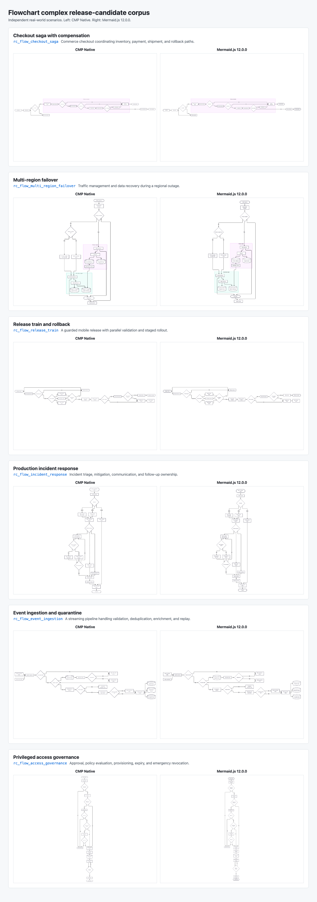

The refreshed 256-case independent-scenario Native/Official detail audit
reports `256 pass / 0 review / 0 fail`. Geometry has 0 ratio reviews with
width `1.028-1.167`, height `0.953-1.173`, and foreground ink
`0.818-1.347`. The stricter edge-topology audit reports
`256 pass / 0 fail`. See the
[Flowchart detail](assets/stability-report/flowchart-visual-parity-detail.json),
[Flowchart geometry](assets/stability-report/flowchart-visual-parity-geometry.json),
[Flowchart topology](assets/stability-report/flowchart-visual-parity-topology.json),
[aggregate detail](assets/stability-report/visual-parity-detail.json), and
[aggregate geometry](assets/stability-report/visual-parity-geometry.json)
reports.

</details>

<details open>
<summary><strong>Cynefin: 13 production scenarios</strong></summary>

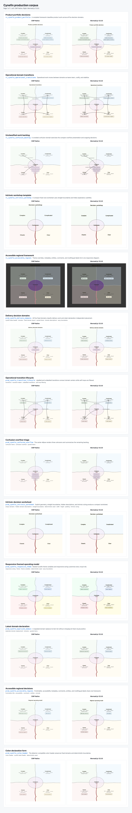

The production geometry and detail audits passed all 13 pairs. Width, height,
and foreground-ink ratios were `1.013-1.021`, `1.011-1.019`, and
`1.019-1.041`; detail was `13 pass / 0 review / 0 fail`.

The fresh 256-case independent-scenario Native/Official audit reports
`256 pass / 0 review / 0 fail`; geometry has 0 hard failures with width
`1.013-1.018`, height `1.011-1.015`, and foreground ink `1.012-1.051`. See the [aggregate detail](assets/stability-report/visual-parity-detail.json) and [aggregate geometry](assets/stability-report/visual-parity-geometry.json) reports.

</details>

<details open>
<summary><strong>Event Modeling: 13 production scenarios</strong></summary>

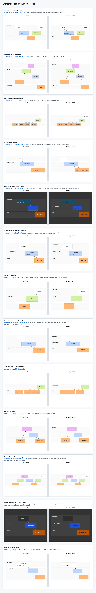

The production geometry audit passed all 13 pairs. Width, height, and
foreground-ink ratios were `1.029-1.044`, `1.013-1.044`, and
`1.029-1.115`. Production detail passed `13 / 13`.

The fresh 256-case independent-scenario Native/Official audit reports
`256 pass / 0 review / 0 fail`; geometry has 0 hard failures with width
`1.019-1.063`, height `1.017-1.092`, and foreground ink `0.964-1.186`. See the [aggregate detail](assets/stability-report/visual-parity-detail.json) and [aggregate geometry](assets/stability-report/visual-parity-geometry.json) reports.

</details>

<details open>
<summary><strong>Agentflow: 13 production scenarios</strong></summary>

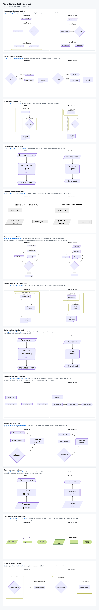

The production geometry audit passed all 13 pairs. Width, height, and
foreground-ink ratios were `1.041-1.186`, `0.820-1.095`, and
`0.766-1.206`. Production detail was `11 pass / 2 review / 0 fail`.
The two collapsed-flow reviews classify the compound summary shape's separator
as a stroke-pattern difference. Geometry counts compare both render objects
and expanded primitives, eliminating the former compound-decomposition
reviews. Manual side-by-side review accepted both remaining cases with
complete labels, equivalent visible geometry, correct edge semantics, and no
clipping, overlap, or paint-order defect.

The fresh 256-case independent-scenario Native/Official audit reports
`256 pass / 0 review / 0 fail`; geometry has 0 hard failures or reviews with
width `1.023-1.196`, height `0.922-1.126`, and foreground ink `0.816-1.152`.
See the [aggregate detail](assets/stability-report/visual-parity-detail.json)
and [aggregate geometry](assets/stability-report/visual-parity-geometry.json)
reports.

</details>

<details open>
<summary><strong>Block: 13 production scenarios</strong></summary>

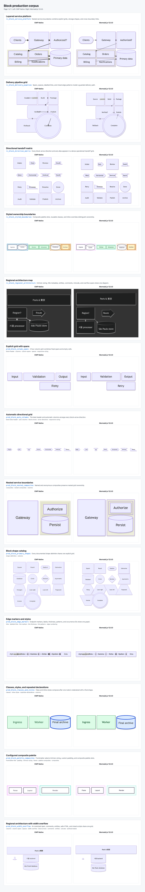

The production geometry and detail audits passed all 13 pairs with
`13 pass / 0 review / 0 fail`. Width, height, and foreground-ink ratios were
`0.970-1.116`, `0.880-1.069`, and `0.908-1.388`.

The fresh 256-case independent-scenario Native/Official audit reports
`256 pass / 0 review / 0 fail`; geometry has 0 hard failures with width
`1.018-1.086`, height `0.934-1.070`, and foreground ink `0.967-1.128`. See the [aggregate detail](assets/stability-report/visual-parity-detail.json) and [aggregate geometry](assets/stability-report/visual-parity-geometry.json) reports.

</details>

<details open>
<summary><strong>Swimlanes: 13 production scenarios</strong></summary>

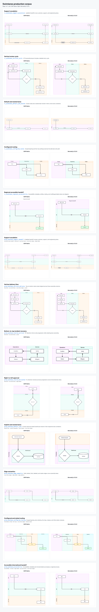

The fresh production geometry, detail, and per-edge topology audits passed all
13 pairs. Width, height, and foreground-ink ratios were `1.028-1.074`,
`0.976-1.070`, and `1.004-1.130`.

The fresh 256-case independent-scenario Native/Official audit reports
`256 pass / 0 review / 0 fail`; geometry has 0 hard failures with width
`1.032-1.057`, height `1.017-1.056`, and foreground ink `0.978-1.127`. Topology is `256/256` pass. See the
[Swimlanes detail](assets/stability-report/swimlanes-visual-parity-detail.json),
[geometry](assets/stability-report/swimlanes-visual-parity-geometry.json), and
[topology](assets/stability-report/swimlanes-visual-parity-topology.json)
reports.

</details>

<details open>
<summary><strong>Architecture: 13 production scenarios</strong></summary>

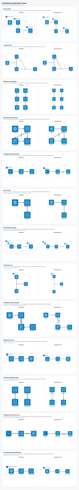

The production geometry and detail audits passed all 13 pairs with
`13 pass / 0 review / 0 fail`. Width, height, and foreground-ink ratios were
`1.020-1.232`, `0.996-1.236`, and `0.985-1.561`.

The fresh 256-case independent-scenario Native/Official audit reports
`251 pass / 5 review / 0 fail`; the remaining reviews are text overlaps in
cases `042`, `178`, `186`, `242`, and `250`. Geometry has
`0 fail / 0 review`, with width `0.990-1.090`, height `0.959-1.173`, and
foreground ink `0.978-1.184`. See the
[aggregate detail](assets/stability-report/visual-parity-detail.json) and
[aggregate geometry](assets/stability-report/visual-parity-geometry.json)
reports.

</details>

<details open>
<summary><strong>C4: 13 production scenarios</strong></summary>

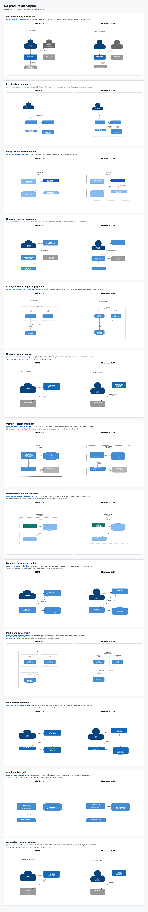

The production geometry passed all 13 pairs. Width, height, and foreground-ink
ratios were `1.028-1.118`, `0.884-1.048`, and `1.004-1.203`. Production
detail passed `13 / 13`. Geometry counts compare both render objects and
expanded primitives, so Official's decomposed database/queue paths and
Native's semantic shapes are validated without a representation-only review.

The fresh 256-case independent-scenario Native/Official audit reports
`256 pass / 0 review / 0 fail`; geometry has 0 hard failures with width
`0.985-1.086`, height `1.044-1.062`, and foreground ink `1.063-1.119`. See the [aggregate detail](assets/stability-report/visual-parity-detail.json) and [aggregate geometry](assets/stability-report/visual-parity-geometry.json) reports.

</details>

<details open>
<summary><strong>Railroad: 18 production scenarios</strong></summary>


The production geometry and detail audits passed all 18 pairs with
`18 pass / 0 review / 0 fail`. Width, height, and foreground-ink ratios were
`1.038-1.120`, `1.028-1.131`, and `1.078-1.281`.

The fresh 256-case independent-scenario Native/Official audit reports
`256 pass / 0 review / 0 fail`; geometry has 0 hard failures with width
`1.003-1.110`, height `1.023-1.101`, and foreground ink `1.051-1.215`. See the [aggregate detail](assets/stability-report/visual-parity-detail.json) and [aggregate geometry](assets/stability-report/visual-parity-geometry.json) reports.

</details>

<details open>
<summary><strong>TreeView: 13 production scenarios</strong></summary>

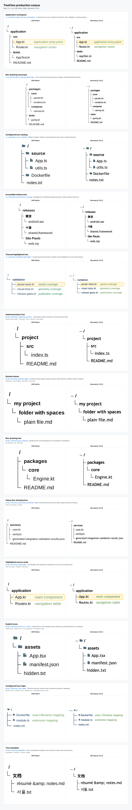

The production geometry and detail audits passed all 13 pairs with
`13 pass / 0 review / 0 fail`. Width, height, and foreground-ink ratios were
`1.011-1.169`, `0.975-1.062`, and `0.930-1.050`.

The fresh 256-case independent-scenario Native/Official audit reports
`256 pass / 0 review / 0 fail`; geometry has 0 hard failures with width
`0.994-1.066`, height `0.970-1.035`, and foreground ink `0.902-1.062`. See the [aggregate detail](assets/stability-report/visual-parity-detail.json) and [aggregate geometry](assets/stability-report/visual-parity-geometry.json) reports.

</details>

<details open>
<summary><strong>Use Case: 18 production scenarios</strong></summary>


The production geometry and detail audits passed all 18 pairs. Width, height,
and foreground-ink ratios were `1.036-1.160`, `0.971-1.115`, and
`1.043-1.316`.

The fresh 256-case independent-scenario Native/Official audit reports
`256 pass / 0 review / 0 fail`; geometry has 0 hard failures with width
`1.022-1.094`, height `0.972-1.059`, and foreground ink `0.979-1.133`. See the [aggregate detail](assets/stability-report/visual-parity-detail.json) and [aggregate geometry](assets/stability-report/visual-parity-geometry.json) reports.

</details>

<details open>
<summary><strong>XY Chart: 13 production scenarios</strong></summary>

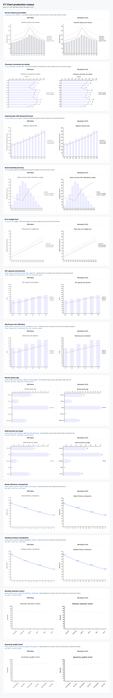

The fresh 256-case independent-scenario Native/Official audit reports
`256 pass / 0 review / 0 fail`; geometry has 0 hard failures with width
`1.012-1.014`, height `1.009-1.012`, and foreground ink `0.934-1.091`. See the [aggregate detail](assets/stability-report/visual-parity-detail.json) and [aggregate geometry](assets/stability-report/visual-parity-geometry.json) reports.

</details>

<details open>
<summary><strong>Quadrant Chart: 13 production scenarios</strong></summary>

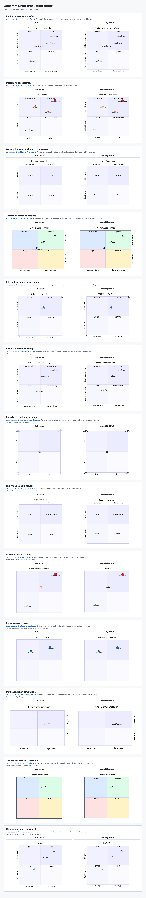

The fresh 256-case independent-scenario Native/Official audit reports
`256 pass / 0 review / 0 fail`; geometry has 0 hard failures with width
`1.014-1.035`, height `1.016-1.025`, and foreground ink `1.026-1.037`. See the [aggregate detail](assets/stability-report/visual-parity-detail.json) and [aggregate geometry](assets/stability-report/visual-parity-geometry.json) reports.

</details>

<details open>
<summary><strong>Timeline: 13 production scenarios</strong></summary>

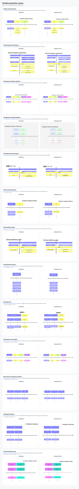

The fresh 256-case independent-scenario Native/Official audit reports
`256 pass / 0 review / 0 fail`; geometry has 0 hard failures with width
`1.026-1.064`, height `1.000-1.074`, and foreground ink `1.020-1.159`. See the [aggregate detail](assets/stability-report/visual-parity-detail.json) and [aggregate geometry](assets/stability-report/visual-parity-geometry.json) reports.

</details>

<details open>
<summary><strong>Sequence: 14 production scenarios</strong></summary>


The fresh 256-case independent-scenario Native/Official audit reports
`256 pass / 0 review / 0 fail`; geometry has 0 hard failures with width
`0.978-1.169`, height `1.013-1.171`, and foreground ink `0.957-1.255`. See the [aggregate detail](assets/stability-report/visual-parity-detail.json) and [aggregate geometry](assets/stability-report/visual-parity-geometry.json) reports.

</details>

<details open>
<summary><strong>Class: 13 production scenarios</strong></summary>

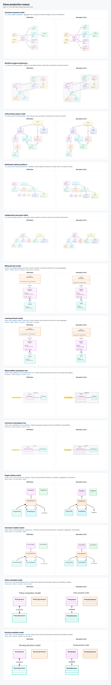

The fresh 256-case independent-scenario Native/Official audit reports
`256 pass / 0 review / 0 fail`; geometry has 0 hard failures or reviews with
width `1.036-1.219`, height `0.870-1.085`, and foreground ink `0.853-1.270`.
See the [aggregate detail](assets/stability-report/visual-parity-detail.json)
and [aggregate geometry](assets/stability-report/visual-parity-geometry.json)
reports.

</details>

<details>
<summary><strong>State: 13 production scenarios</strong></summary>

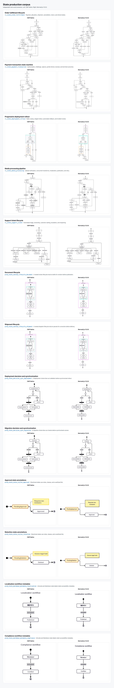

The fresh 256-case independent-scenario Native/Official audit reports
`256 pass / 0 review / 0 fail`; geometry has 0 hard failures with width
`0.978-1.069`, height `1.013-1.186`, and foreground ink `0.801-1.175`. See the [aggregate detail](assets/stability-report/visual-parity-detail.json) and [aggregate geometry](assets/stability-report/visual-parity-geometry.json) reports.

</details>

<details open>
<summary><strong>Entity Relationship: 13 production scenarios</strong></summary>

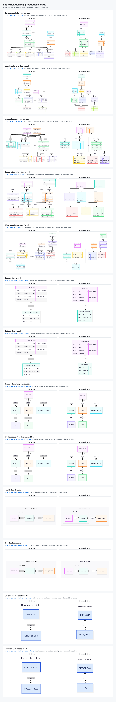

The fresh 256-case independent-scenario Native/Official audit reports
`256 pass / 0 review / 0 fail`; geometry has 0 review or hard failures with
width `1.029-1.079`, height `1.004-1.061`, and foreground ink `0.548-0.979`.
See the [aggregate detail](assets/stability-report/visual-parity-detail.json)
and [aggregate geometry](assets/stability-report/visual-parity-geometry.json)
reports.

</details>

<details open>
<summary><strong>Gantt: 13 production scenarios</strong></summary>

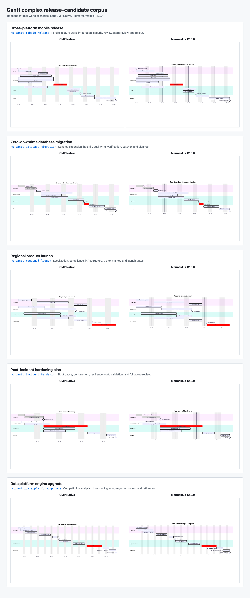

The fresh 256-case independent-scenario Native/Official audit reports
`256 pass / 0 review / 0 fail`; geometry has 0 review or hard failures with width
`1.034-1.037`, height `0.927-0.957`, and foreground ink `0.921-1.029`. See the [aggregate detail](assets/stability-report/visual-parity-detail.json) and [aggregate geometry](assets/stability-report/visual-parity-geometry.json) reports.

</details>

<details>
<summary><strong>Pie: 13 production scenarios</strong></summary>

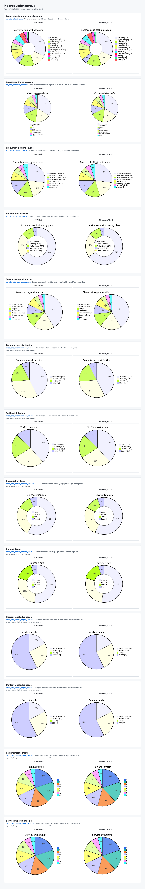

The fresh 256-case independent-scenario Native/Official audit reports
`256 pass / 0 review / 0 fail`; geometry has 0 hard failures with width
`1.004-1.065`, height `0.991-1.015`, and foreground ink `0.988-1.039`. See the [aggregate detail](assets/stability-report/visual-parity-detail.json) and [aggregate geometry](assets/stability-report/visual-parity-geometry.json) reports.

</details>

<details open>
<summary><strong>User Journey: 13 production scenarios</strong></summary>

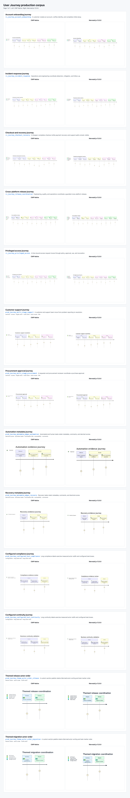

The fresh 256-case independent-scenario Native/Official audit reports
`256 pass / 0 review / 0 fail`; geometry has 0 hard failures with width
`0.979-1.032`, height `0.919-1.055`, and foreground ink `0.828-1.090`. See the [aggregate detail](assets/stability-report/visual-parity-detail.json) and [aggregate geometry](assets/stability-report/visual-parity-geometry.json) reports.

</details>

<details open>
<summary><strong>Requirement: 13 production scenarios</strong></summary>

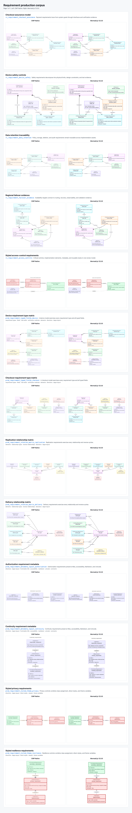

The fresh 256-case independent-scenario Native/Official audit reports
`256 pass / 0 review / 0 fail`; geometry has 0 hard failures with width
`1.027-1.071`, height `1.006-1.055`, and foreground ink `0.954-1.104`. See the [aggregate detail](assets/stability-report/visual-parity-detail.json) and [aggregate geometry](assets/stability-report/visual-parity-geometry.json) reports.

</details>

<details open>
<summary><strong>Git Graph: 13 production scenarios</strong></summary>

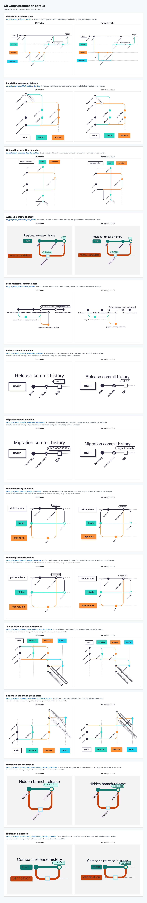

The replacement detail audit accepted all 13 production pairs:
`12 pass / 1 manually reviewed / 0 fail`. The single review is a
text-overlap threshold finding caused by browser/Compose text-bound
differences; all four expected text elements match, no text is clipped,
P95 normalized text-center distance is `0.052`, mask IoU is `0.742`, and edge
F1 is `0.823`. Production width, height, and foreground-ink ratios are
`1.048-1.129`, `1.047-1.146`, and `1.074-1.342`.

The fresh 256-case independent-scenario Native/Official audit reports
`256 pass / 0 review / 0 fail`; geometry has 0 hard failures with width
`1.063-1.155`, height `1.059-1.137`, and foreground ink `1.066-1.419`. See the [aggregate detail](assets/stability-report/visual-parity-detail.json) and [aggregate geometry](assets/stability-report/visual-parity-geometry.json) reports.

</details>

<details open>
<summary><strong>Mindmap: 13 production scenarios</strong></summary>

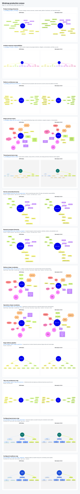

The refreshed production audit accepted all 13 pairs:
`9 pass / 4 manually reviewed / 0 fail`. Production width, height, and
foreground-ink ratios are `0.949-1.122`, `0.863-1.049`, and `0.742-1.049`.
The refreshed production contact sheet was manually reviewed with no missing
content, clipping, or overlap.

The fresh 256-case independent-scenario Native/Official audit reports
`256 pass / 0 review / 0 fail`; geometry has 0 hard failures with width
`1.023-1.113`, height `0.809-1.106`, and foreground ink `0.927-1.141`. See the [aggregate detail](assets/stability-report/visual-parity-detail.json) and [aggregate geometry](assets/stability-report/visual-parity-geometry.json) reports.

</details>

<details open>
<summary><strong>Kanban: 13 production scenarios</strong></summary>

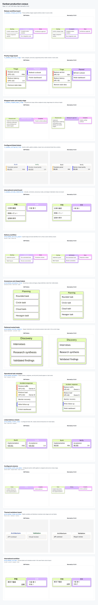

The fresh 256-case independent-scenario Native/Official audit reports
`254 pass / 2 review / 0 fail`; geometry has 0 hard failures with width
`1.012-1.088`, height `0.895-1.154`, and foreground ink `0.999-1.144`. Case
035 confirms single-line `Declare`, `Inspect`, and `Shipment` labels plus
section-label `textColor` inheritance. See the [aggregate detail](assets/stability-report/visual-parity-detail.json) and [aggregate geometry](assets/stability-report/visual-parity-geometry.json) reports.

</details>

<details open>
<summary><strong>Packet: 13 production scenarios</strong></summary>

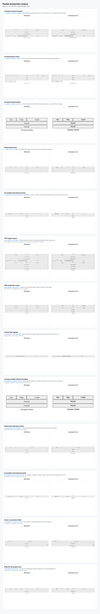

The fresh 256-case independent-scenario Native/Official audit reports
`256 pass / 0 review / 0 fail`; geometry has 0 hard failures with width
`1.010-1.023`, height `1.000-1.067`, and foreground ink `0.993-1.071`. See the [aggregate detail](assets/stability-report/visual-parity-detail.json) and [aggregate geometry](assets/stability-report/visual-parity-geometry.json) reports.

</details>

<details open>
<summary><strong>Radar: 13 production scenarios</strong></summary>

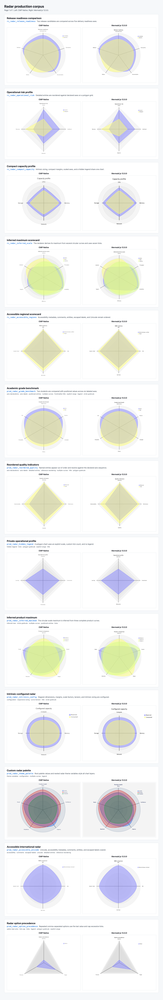

The fresh 256-case independent-scenario Native/Official audit reports
`256 pass / 0 review / 0 fail`; geometry has 0 hard failures with width
`1.012-1.037`, height `1.018-1.020`, and foreground ink `1.034-1.038`. See the [aggregate detail](assets/stability-report/visual-parity-detail.json) and [aggregate geometry](assets/stability-report/visual-parity-geometry.json) reports.

</details>

<details open>
<summary><strong>Sankey: 13 production scenarios</strong></summary>

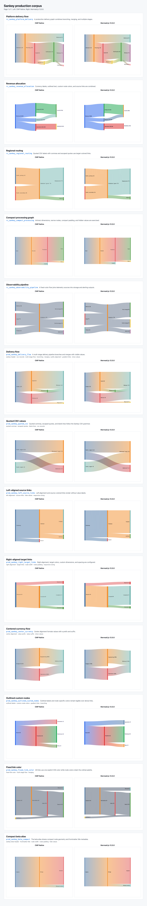

The fresh 256-case independent-scenario Native/Official audit reports
`256 pass / 0 review / 0 fail`; geometry has 0 hard failures with width
`1.053-1.053`, height `1.052-1.053`, and foreground ink `1.109-1.112`. See the [aggregate detail](assets/stability-report/visual-parity-detail.json) and [aggregate geometry](assets/stability-report/visual-parity-geometry.json) reports.

</details>

<details open>
<summary><strong>Treemap: 13 production scenarios</strong></summary>

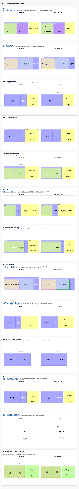

The fresh 256-case independent-scenario Native/Official audit reports
`256 pass / 0 review / 0 fail`; geometry has 0 hard failures with width
`1.037-1.038`, height `1.032-1.034`, and foreground ink `1.069-1.085`. See the [aggregate detail](assets/stability-report/visual-parity-detail.json) and [aggregate geometry](assets/stability-report/visual-parity-geometry.json) reports.

</details>

<details open>
<summary><strong>Venn: 13 production scenarios</strong></summary>

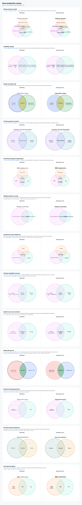

The fresh 256-case independent-scenario Native/Official audit reports
`256 pass / 0 review / 0 fail`; geometry has 0 hard failures with width
`1.011-1.023`, height `1.005-1.011`, and foreground ink `1.016-1.031`. See the [aggregate detail](assets/stability-report/visual-parity-detail.json) and [aggregate geometry](assets/stability-report/visual-parity-geometry.json) reports.

</details>

<details open>
<summary><strong>Ishikawa: 13 production scenarios</strong></summary>

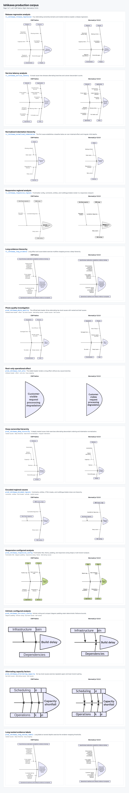

The production geometry audit passed all 13 pairs. Width, height, and
foreground-ink ratios were `1.040-1.188`, `1.059-1.119`, and `1.067-1.326`.
The production detail result was `12 pass / 1 review / 0 fail`. The root-only
review is a manifest-only element-count difference: Native retains the
zero-length spine while Official omits it from visible geometry. Raster output
and effect semantics match.

The fresh 256-case independent-scenario Native/Official audit reports
`256 pass / 0 review / 0 fail`; geometry has 0 hard failures with width
`1.038-1.119`, height `1.028-1.098`, and foreground ink `1.034-1.227`. See the [aggregate detail](assets/stability-report/visual-parity-detail.json) and [aggregate geometry](assets/stability-report/visual-parity-geometry.json) reports.

</details>

<details open>
<summary><strong>Wardley Map: 13 production scenarios</strong></summary>

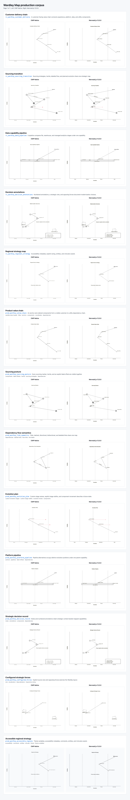

The replacement production detail and geometry audits passed all 13 pairs with
`13 pass / 0 review / 0 fail`. Production width, height, and foreground-ink
ratios were `1.008-1.015`, `1.019-1.020`, and `0.970-1.106`.

The fresh 256-case independent-scenario Native/Official audit reports
`256 pass / 0 review / 0 fail`; geometry has 0 hard failures with width
`1.008-1.008`, height `1.019-1.020`, and foreground ink `1.016-1.095`. See the [aggregate detail](assets/stability-report/visual-parity-detail.json) and [aggregate geometry](assets/stability-report/visual-parity-geometry.json) reports.

</details>

<details open>
<summary><strong>ZenUML: 13 production scenarios</strong></summary>

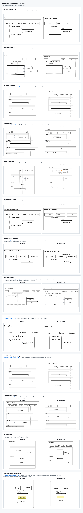

The replacement production detail and geometry audits passed all 13 pairs with
`13 pass / 0 review / 0 fail`. Production width, height, and foreground-ink
ratios were `1.042-1.100`, `1.039-1.102`, and `1.094-1.238`.

The fresh 256-case independent-scenario Native/Official audit reports
`256 pass / 0 review / 0 fail`; geometry has 0 hard failures with width
`1.041-1.093`, height `1.042-1.089`, and foreground ink `1.013-1.265`. See the [aggregate detail](assets/stability-report/visual-parity-detail.json) and [aggregate geometry](assets/stability-report/visual-parity-geometry.json) reports.

</details>

The generated capture metadata, byte sizes, and SHA-256 values are available in

[`manifest.json`](assets/stability-report/manifest.json). Per-case Native versus
Official content bounds, foreground density, ratios, thresholds, and failures
are recorded in
[`geometry-report.json`](assets/stability-report/geometry-report.json).

## Automated Test Evidence

The repository-level
[`Quality Gate`](../.github/workflows/quality.yml) repeats the JVM tests,
cross-platform builds, generated-corpus and capability-coverage checks, source
and credential scan, production runtime-isolation check, debug/release APK
permission audit, independent-corpus capture, malformed-source error capture,
visual geometry gate, and Web load test on every push to `main` and every pull
request. The
[`Full Visual Parity`](../.github/workflows/full-visual-parity.yml) workflow
runs the 8,448-pair independent-scenario visual matrix weekly and on demand in
33 parallel diagram jobs. The Flowchart job enforces its dedicated coverage
contract; every other job enforces a complete eight-axis matrix, pairwise
balance, source-effective axis flips, distinct normalized sources, and its
structural-profile floor before geometry and detail gates run. Rendered
manifest and PNG uniqueness remain diagnostics.

The previously published cross-platform verification command completed
successfully:

```bash
JAVA_HOME=$(/usr/libexec/java_home -v 17) ./gradlew \
  :mermaid-core:jvmTest \
  :mermaid-compose:jvmTest \
  :sample:androidApp:assembleDebug \
  :sample:androidApp:assembleRelease \
  :sample:webApp:wasmJsBrowserDistribution \
  :sample:desktopApp:createDistributable \
  :mermaid-core:compileKotlinIosArm64 \
  :mermaid-core:compileKotlinIosSimulatorArm64 \
  :mermaid-core:compileKotlinIosX64 \
  :mermaid-compose:compileKotlinIosArm64 \
  :mermaid-compose:compileKotlinIosSimulatorArm64 \
  :mermaid-compose:compileKotlinIosX64 \
  :mermaid-debug-ui:compileKotlinIosArm64 \
  :mermaid-debug-ui:compileKotlinIosSimulatorArm64 \
  :mermaid-debug-ui:compileKotlinIosX64
```

Result:

```text
BUILD SUCCESSFUL
mermaid-core: 717 tests
mermaid-compose: 28 tests
total: 745 tests
failures: 0
errors: 0
```

The retained pre-formula source-level JVM run was green:

```text
mermaid-core: 1,019 tests; 1,019 passed
mermaid-compose: 38 tests; 38 passed
total: 1,057 tests; 1,057 passed
failures: 0
errors: 0
```

The corresponding historical Wasm run passed: Core `1,017/1,017`, Compose
`37/37`, and debug UI `9/9`.

The `0.1.16` mixed-formula safety run passes JVM Core `1,084/1,084` and
Compose `69/69`, Wasm Core `1,082/1,082` and Compose `62/62`, and iOS
Simulator Arm64 Core `1,082/1,082` and Compose `76/76`. These counts are
computed from the complete platform test-result XML files. The formula
reference fixture also passes `2/2` after binding the existing Noto Sans Math
resource: the previous fixture used an unrecorded system MathML font and is
not a reproducible input across systems.

The new safety cases reject aggregate non-finite formula geometry, retain
Requirement's upstream HTML-label configuration, and cover cancelled,
oversized, malformed, and truncated iOS image completions. The bridge checks
encoded dimensions before allocating pixels, requires complete decoding, and
closes temporary native resources. The dedicated audit tooling has 42 passing
test entries for topology, absolute item placement, and capture freshness.
These tests do not establish physical-device parity for a host formula engine.

The current independent corpus test is
[`ProductionCorpusTest`](../mermaid-core/src/commonTest/kotlin/com/swithun/cmpmermaid/core/ProductionCorpusTest.kt).
It compiles all 441 sources and rejects parser errors, invalid or non-finite
geometry, scenes outside the 20,000-unit and 20,000-element limits, empty
SceneGraphs, and non-deterministic replay. The 274 conformance cases also
require selected semantic text to survive parsing and layout. The test renders
a representative of all 33 implemented diagram types with each of the 11 built-in
themes.

[`InvalidSourceCorpusTest`](../mermaid-core/src/commonTest/kotlin/com/swithun/cmpmermaid/core/InvalidSourceCorpusTest.kt)
requires all 8,448 source mutations to return deterministic results, verifies
that every rejection is a non-empty `CONTENT_ERROR`, and checks that every
family can render a valid source after each mutation profile.
[`InvalidSourceOfficialErrorParityTest`](../mermaid-core/src/jvmTest/kotlin/com/swithun/cmpmermaid/core/InvalidSourceOfficialErrorParityTest.kt)
verifies Native accept/reject outcomes against the published Mermaid.js
manifest for all 8,448 mutations.

`ProductionCorpusTest` additionally verifies the accounting of all 8,448
text/layout stress inputs and renders all 8,448 independent visual scenarios,
checking the 256-per-family accounting, unique scenario titles, normalized
semantic signatures, expected visible text, and finite non-empty SceneGraphs.
The retained historical deterministic stress
baseline contains 7,936 Native-only inputs across the 31 families included
when it was captured.
Unified graph diagrams exercise Dagre, while Mindmap exercises CoSE-Bilkent,
Dagre, and tidy tree.

## Determinism And Performance Evidence

Every one of the 441 independent scenarios is rendered twice and compared as a
complete `MermaidScene`, including dimensions, elements, paths, text, styles,
metadata, and z-order.

The published JVM production soak performs two warmup rounds followed by five
measured rounds over the preceding 415-scenario corpus:

```text
renders=2,075
total=674ms
p95=1ms
retainedHeap=63,968 bytes
```

Enforced budgets are 45 seconds total, 500ms P95, and 64MiB retained heap after
forced GC.

## Runtime Load Matrix

The shared load screen renders exactly one production-corpus case at a time
and advances only after an explicit render result. The current physical-device
evidence is split into three independent tracks:

- Kotlin `2.3.20` Android: 8/8 devices across Android 9-16;
- Kotlin `1.7.21` Android: the same 8/8 device matrix; and
- iOS: 6/6 devices across iOS 14.3-26.0.

Together these runs completed 9,702 corpus renders with no crash, Android ANR,
or process exit. The separate visual gate reviewed 198 sentinel screenshots
plus 22 final completion screenshots.

**[Open the Android physical-device compatibility report and visual evidence](android-real-device-compatibility.md).**

**[Open the iOS physical-device compatibility report and visual evidence](ios-real-device-compatibility.md).**

The latest Web runtime baseline covers the preceding 397 scenarios and walks
from the first Flowchart to the final Agentflow case. iOS Simulator and Desktop
retain the preceding 236-scenario run through the final Sankey case; those rows
are historical baselines, not evidence for the subsequently implemented
families.

The automated Web scroll budget scales with the corpus at 80ms per case, with
a 15-second minimum. First content remains capped at 15 seconds and retained
JavaScript heap at 96MiB.

| Platform | Corpus | Result | Local evidence |
| --- | ---: | --- | --- |
| Android physical devices, Kotlin 2.3.20 | 441 x 8 | Passed post-fix matrix | 53-78s per device; 8/8 completed; 0 crashes or ANRs; 72 sentinels reviewed |
| Android physical devices, Kotlin 1.7.21 | 441 x 8 | Passed post-fix matrix | 52-77s per device; 8/8 completed; 0 crashes or ANRs; 72 sentinels reviewed |
| iOS physical devices | 441 x 6 | Passed physical-device matrix | 57-123s per device; 6/6 completed; 0 new crash reports; 54 sentinels reviewed |
| Android Emulator | 236 | Prior baseline passed | Retained historical baseline through Sankey |
| iOS Simulator | 236 | Prior baseline passed | Completion marker at 23s; 358MiB peak and final host RSS; no crash |
| Desktop | 236 | Prior baseline passed | Completion marker in three consecutive runs; latest 21s and 432MiB RSS |
| Web | 397 | Passed in 22,455ms after 1,227ms first content | 185 scroll events; 18,417,340 bytes retained JS heap; final Agentflow case reached; no browser errors |

Machine-readable measurements:
[Android](assets/runtime-load/android-emulator-metrics.json),
[iOS](assets/runtime-load/ios-simulator-metrics.json),
[Desktop](assets/runtime-load/desktop-metrics.json), and
[Web](assets/runtime-load/web-metrics.json).

The Android Emulator and iOS Simulator screenshots show the final Sankey case
from the 236-scenario baseline. The Web screenshot shows the final Agentflow
case from the preceding 397-scenario corpus:

| Android Emulator | iOS Simulator |
| :---: | :---: |
| 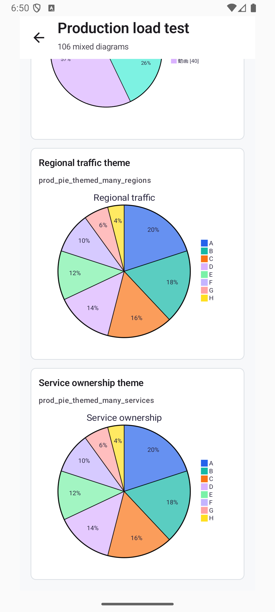 | 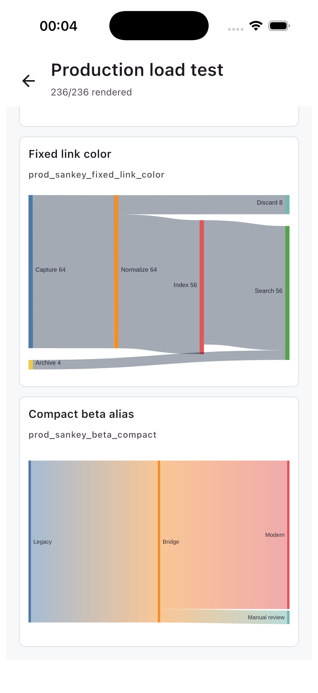 |

| Web |
| :---: |
| 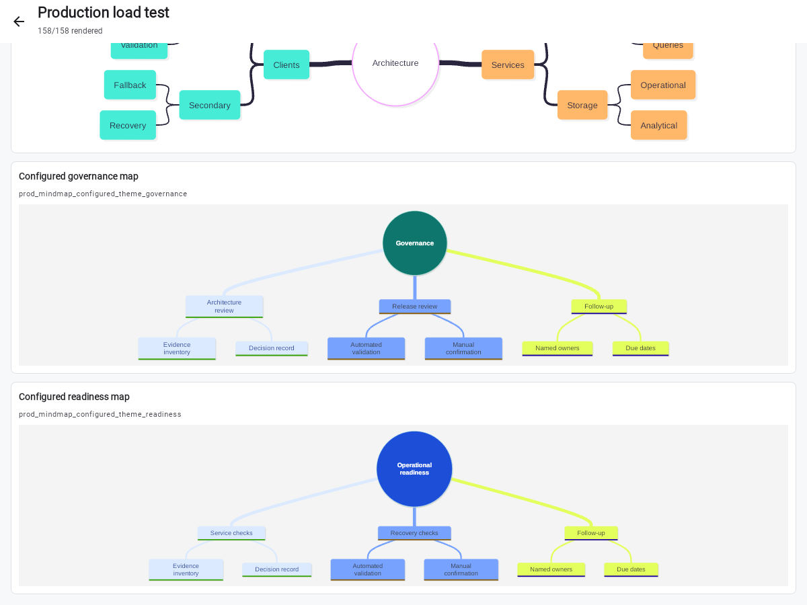 |

The current Desktop run is represented by its machine-readable process,
completion-marker, timing, and RSS record. The automated macOS session could
not capture the application window, so the older 132-case Desktop image is
intentionally not used as current Sankey evidence.

The Android matrix identified and fixed an Android ICU incompatibility in an
Agentflow metadata-whitespace regular expression. The complete matrix passed
after escaping the literal closing brace and adding focused parser regression
tests.

The iOS and Desktop runs identified and fixed the same class of native font
concurrency defect: background text measurement could race Compose/Skia glyph
drawing and crash in CoreText. iOS now uses `Dispatchers.Main.immediate`;
Desktop uses an explicit Swing EDT dispatcher. Android and Web retain
`Dispatchers.Default`.

## APK Permission Audit

Audited artifacts:

```text
sample/androidApp/build/outputs/apk/debug/androidApp-debug.apk
sample/androidApp/build/outputs/apk/release/androidApp-release-unsigned.apk
```

Declared permissions:

```text
com.swithun.cmpmermaid.sample.DYNAMIC_RECEIVER_NOT_EXPORTED_PERMISSION
```

`android.permission.INTERNET` is not declared.

## Reproduce The Report

```bash
cd tools/official-reference
npm run generate:stability-corpus
npm run generate:invalid-source-corpus

cd ../..
JAVA_HOME=$(/usr/libexec/java_home -v 17) \
  ./gradlew \
    :mermaid-core:jvmTest \
    :mermaid-compose:jvmTest \
    :sample:androidApp:assembleDebug \
    :sample:androidApp:assembleRelease \
    :sample:webApp:wasmJsBrowserDistribution \
    :sample:desktopApp:createDistributable

python3 -m http.server 8093 \
  --directory sample/webApp/build/dist/wasmJs/productionExecutable \
  >/tmp/cmp-mermaid-web.log 2>&1 &
WEB_SERVER_PID=$!
trap 'kill "$WEB_SERVER_PID"' EXIT

cd tools/official-reference
AUDIT_SOURCE=production \
OUTPUT_DIR=captures/local/production-corpus \
BASE_URL=http://127.0.0.1:8093/ \
VIEWPORT_WIDTH=1200 \
VIEWPORT_HEIGHT=900 \
npm run capture:web-audit

AUDIT_SOURCE=invalid-source \
INVALID_SOURCE_SCOPE=full \
OUTPUT_DIR=captures/local/invalid-source \
BASE_URL=http://127.0.0.1:8093/ \
VIEWPORT_WIDTH=1200 \
VIEWPORT_HEIGHT=900 \
npm run capture:web-audit

CORPUS_SOURCE=production \
INPUT_DIR=captures/local/production-corpus \
OUTPUT_FILE=captures/local/production-corpus/geometry-report.json \
npm run audit:stability-geometry

BASE_URL=http://127.0.0.1:8093/ \
OUTPUT_DIR=captures/local/load-test-web \
npm run test:web-load

CORPUS_SOURCE=production \
INPUT_DIR=captures/local/production-corpus \
OUTPUT_DIR=captures/local/production-contact-sheets \
npm run generate:stability-contact-sheets

INPUT_DIR=captures/local/invalid-source \
OUTPUT_DIR=docs/assets/invalid-source-report \
INVALID_SOURCE_SCOPE=full \
CONTACT_SHEET_PAGE_SIZE=16 \
npm run generate:invalid-source-contact-sheets

AUDIT_SOURCE=visual-parity \
OUTPUT_DIR=captures/local/visual-parity \
BASE_URL=http://127.0.0.1:8093/ \
VIEWPORT_WIDTH=1200 \
VIEWPORT_HEIGHT=900 \
npm run capture:web-audit

INPUT_DIR=captures/local/visual-parity \
OUTPUT_FILE=docs/assets/stability-report/visual-scenario-duplicate-audit.json \
npm run audit:visual-scenario-duplicates

CORPUS_SOURCE=visual-parity \
INPUT_DIR=captures/local/visual-parity \
OUTPUT_FILE=docs/assets/stability-report/visual-parity-geometry.json \
npm run audit:stability-geometry

CORPUS_SOURCE=visual-parity \
INPUT_DIR=captures/local/visual-parity \
OUTPUT_FILE=docs/assets/stability-report/visual-parity-detail.json \
HEATMAP_DIR=captures/local/visual-parity/detail-diffs \
FAIL_ON_REVIEW=false \
npm run audit:detail

CORPUS_SOURCE=visual-parity \
INPUT_DIR=captures/local/visual-parity \
OUTPUT_DIR=docs/assets/stability-report \
CONTACT_SHEET_PAGE_SIZE=16 \
npm run generate:stability-contact-sheets
```

The capture command fails if a requested Native canvas or Official SVG does not
appear, if Mermaid reports an error, if an Official Gantt viewBox collapses, or
if a screenshot is below the minimum size. The geometry gate rejects blank
images and severe width, height, or foreground-density differences. The
contact-sheet generator verifies every expected pair and records its SHA-256.
For `AUDIT_SOURCE=invalid-source`, Mermaid.js is captured first as the outcome
oracle. Capture fails if Native disagrees, if a Native rejection is not
`CONTENT_ERROR`, or if either rejection has an empty message. The contact-sheet
generator enforces outcome parity and records exact diagnostic-message equality
as a separate metric.
Set `AUDIT_KIND` and `CORPUS_KIND` to one of the 33 diagram IDs to reproduce
a single 256-case source-mutation partition instead of the complete matrix. The
[`Full Invalid Source Matrix`](../.github/workflows/full-invalid-source.yml)
workflow runs those 33 partitions in parallel. The regular Quality Gate uses
`INVALID_SOURCE_SCOPE=smoke`, which keeps the first variant of all 16 mutation
classes for every family without serially recapturing all 16,896 screenshots
on every push.

## Stable Acceptance Criteria

The Stable label requires all of these code-level gates:

- the independent complex corpus has no blocked visual category;
- Native/Official comparison includes automated semantic or perceptual
  thresholds with reviewed exceptions;
- the Quality Gate workflow is required and green on `main`;
- Android, Web, iOS, and Desktop have runtime smoke evidence, not compile-only
  evidence;
- bulk rendering has repeatable memory, latency, and long-running soak limits;
- no open high-severity correctness, crash, resource-exhaustion, or
  data-exposure defect exists for the supported contract.

The retranslated Swimlanes implementation now satisfies its classic-look
evidence gates: the source map, translated tests, DDLT, production, 256-case
detail and geometry, per-edge topology, and manual contact-sheet review are
current. Its mapped `look: handDrawn` case remains a structured unsupported
result. Flowchart's refreshed detail and per-edge topology matrices now pass
all 256 cases. Architecture's default fCoSE/CoSE/layout-base path is
translated, but `randomize: true` remains unsupported and five detail cases
remain under review. Kanban also retains two font-metric review cases. The
full JVM and Wasm core runs pass. The public code status is therefore
**not Stable** until the mapped unsupported capabilities and detail reviews
are resolved. The Android Kotlin 2.3.20, Android Kotlin
1.7.21, and iOS 441-case physical-device loads predate the Swimlanes
retranslation and remain historical evidence for that family.
